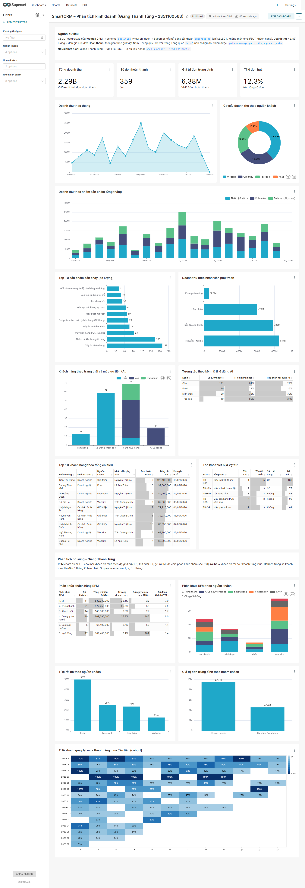
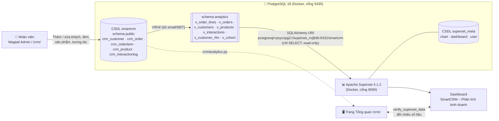
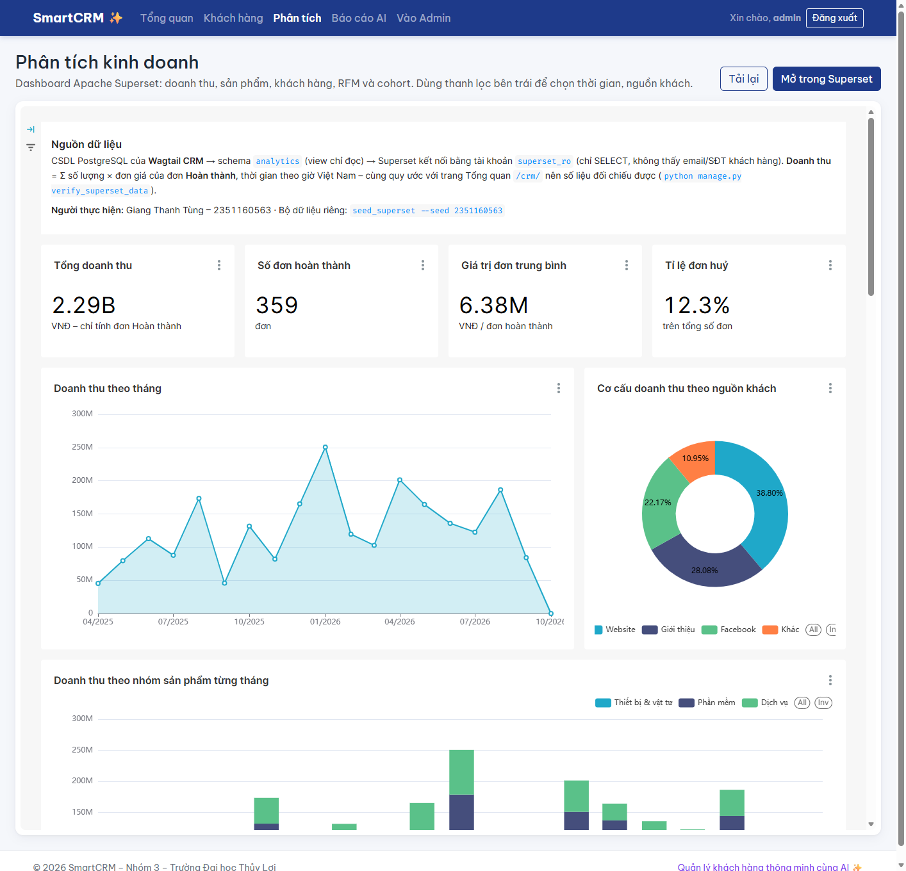

# TH1 – Tích hợp Wagtail ERP/CRM (SmartCRM) với Apache Superset

Nhánh: `th1/superset` (bài cá nhân – tách từ `feature/ai-classify-report`, không gộp vào nhánh nhóm).



## Mục lục
1. [Kiến trúc & luồng dữ liệu](#1-kiến-trúc--luồng-dữ-liệu)
2. [Checklist 01–05 ↔ file](#2-checklist-0105--file)
3. [Chạy từ đầu (lệnh đầy đủ)](#3-chạy-từ-đầu-lệnh-đầy-đủ)
4. [Chi tiết từng checklist](#4-chi-tiết-từng-checklist)
5. [Bảo mật kết nối](#5-bảo-mật-kết-nối)
6. [Kịch bản quay video nộp bài](#6-kịch-bản-quay-video-nộp-bài)
7. [Xử lý sự cố](#7-xử-lý-sự-cố)
8. [Cá nhân hoá bài làm](#8-cá-nhân-hoá-bài-làm)
9. [Nhúng dashboard vào SmartCRM](#9-nhúng-dashboard-vào-smartcrm)

---

## 1. Kiến trúc & luồng dữ liệu



**Điểm chính**
- Wagtail vẫn ghi dữ liệu như cũ, chỉ đổi SQLite sang **PostgreSQL** (Superset chặn SQLite vì lý do an toàn, và container không đọc được file `.sqlite3` trên Windows).
- Superset **không đọc bảng gốc**. Nó chỉ đọc tầng view `analytics`, bằng tài khoản `superset_ro` chỉ có quyền đọc.
- Metadata của Superset (chart, dashboard, tài khoản) nằm trong CSDL riêng `superset_meta`, tách khỏi dữ liệu nghiệp vụ.
- Doanh thu có **cùng một định nghĩa** ở cả hai phía: Σ số lượng × đơn giá của đơn *Hoàn thành*, tính theo giờ Việt Nam. Nhờ vậy dashboard Superset và trang `/crm/` đối chiếu được với nhau.

## 2. Checklist 01–05 ↔ file

| # | Yêu cầu | Trạng thái | File / lệnh chính |
|---|---|---|---|
| 01 | Thiết lập CSDL cho Wagtail ERP/CRM, chuẩn bị dữ liệu mẫu (khách hàng, đơn hàng, doanh thu) | ✅ | `smartcrm/settings/base.py` (`DB_ENGINE=postgres`), `docker-compose.yml` (dịch vụ `db`), `requirements.txt` (`psycopg`), `crm/management/commands/seed_superset.py`, `sql/superset/01_analytics_views.sql` |
| 02 | Cài đặt, cấu hình Apache Superset trong Docker | ✅ | `docker-compose.yml` (`superset`, `superset-init`), `superset/Dockerfile` (thêm driver `psycopg2`), `superset/superset_config.py`, `docker/postgres/10_superset_meta.sh` |
| 03 | Kết nối Superset với CSDL Wagtail qua SQLAlchemy URI | ✅ | `sql/superset/02_superset_readonly_user.sql` (tài khoản chỉ đọc), `superset/bootstrap_dashboard.py` → `ensure_database()` |
| 04 | Khám phá dữ liệu (Dataset), tạo biểu đồ theo nghiệp vụ CRM | ✅ | 7 dataset, 18 metric dùng chung, 18 biểu đồ (gồm 5 biểu đồ phân tích bổ sung: RFM, rời bỏ, cohort): `superset/bootstrap_dashboard.py` (`DATASETS`, `CHARTS`) |
| 05 | Dashboard tổng hợp, kiểm tra tính chính xác dữ liệu | ✅ | Dashboard `smartcrm-th1` có 4 bộ lọc; `crm/management/commands/verify_superset_data.py` (12 chỉ số, 3 nguồn); VERIFY trong 2 file SQL; `crm/tests/test_seed_superset.py` |

Kiểm thử: `python manage.py test crm` cho **86/86 PASS** trên cả SQLite lẫn PostgreSQL (81 test cũ + 5 test mới).

## 3. Chạy từ đầu (lệnh đầy đủ)

> Chạy trong thư mục `smartcrm/`, bằng PowerShell, với venv đã kích hoạt. Các lệnh `docker compose exec` đều chạy được trên cả PowerShell lẫn bash.

**Bước 0 – cấu hình `.env`.** Sao chép các khối `CSDL (TH1 Superset)` và `Apache Superset` từ `.env.example` vào `.env`, rồi điền mật khẩu. Có thể sinh mật khẩu ngẫu nhiên bằng:
```powershell
python -c "import secrets; print(secrets.token_urlsafe(18))"
```
Các biến cần đặt: `DB_ENGINE=postgres`, `DB_PASSWORD`, `SUPERSET_SECRET_KEY` (≥ 32 ký tự), `SUPERSET_ADMIN_PASSWORD`, `SUPERSET_META_PASSWORD`, `SUPERSET_RO_PASSWORD`, và thông tin cá nhân `STUDENT_NAME`, `STUDENT_ID`, `TH1_SEED` (xem [mục 8](#8-cá-nhân-hoá-bài-làm)). Nếu cổng 5435/8088 đã bị chiếm, đổi `DB_PORT` và `SUPERSET_PORT` (máy hiện tại dùng `SUPERSET_PORT=8090`).

```powershell
pip install -r requirements.txt

# 01 – CSDL + dữ liệu
docker compose up -d db
python manage.py migrate
python manage.py createsuperuser
python manage.py seed_demo --analyze                 # 10 khách mẫu có kịch bản (dùng cho demo AI)
python manage.py seed_superset --analyze             # 150 khách, ~480 đơn, 18 tháng (seed = TH1_SEED)
docker compose exec db psql -U smartcrm -d smartcrm -v ON_ERROR_STOP=1 -f /sql/01_analytics_views.sql

# 03 – tài khoản chỉ đọc cho Superset
docker compose exec db sh -c 'psql -U smartcrm -d smartcrm -v ON_ERROR_STOP=1 -v ro_password="$SUPERSET_RO_PASSWORD" -f /sql/02_superset_readonly_user.sql'

# 02 – Superset
docker compose build superset
docker compose --profile init run --rm superset-init      # CHỈ chạy 1 lần: metadata + tài khoản admin
docker compose up -d superset                             # http://localhost:8090 (theo SUPERSET_PORT)

# 03–05 – dựng sẵn kết nối, dataset, biểu đồ, dashboard (tuỳ chọn, xem mục 4)
python superset/bootstrap_dashboard.py              # --force để xoá và dựng lại
python manage.py verify_superset_data --superset    # 05 – đối chiếu số liệu

python manage.py runserver                           # Wagtail: http://127.0.0.1:8000/crm/
```

> **Quy tắc dữ liệu mẫu:** `seed_superset`, `superset-init` và các file SQL đều là lệnh **chạy thủ công**. Chúng không nằm trong luồng khởi động container, nên restart không bị chậm và không sinh dữ liệu trùng.

## 4. Chi tiết từng checklist

### 01 – Thiết lập CSDL và dữ liệu mẫu

**Chuyển Wagtail sang PostgreSQL.** `settings/base.py` đọc `DB_ENGINE`. Nếu không đặt biến này, hệ thống vẫn dùng SQLite, nên máy của các thành viên khác không bị ảnh hưởng. Khi dùng Postgres, cấu hình tự thêm `django.contrib.postgres` (chỉ mục tìm kiếm của Wagtail cần).

**Sinh dữ liệu: `python manage.py seed_superset`**

| Tham số | Mặc định | Ý nghĩa |
|---|---|---|
| `--customers` | 150 | Số khách hàng mẫu (email `@sample.smartcrm.vn`) |
| `--months` | 18 | Số tháng dữ liệu tính tới hôm nay |
| `--seed` | `TH1_SEED` trong `.env` (không có thì 2026) | Hạt giống ngẫu nhiên. Cùng giá trị cho ra cùng bộ số liệu; **đổi giá trị để có bộ dữ liệu của riêng bạn** |
| `--reset` | – | Xoá dữ liệu do lệnh này tạo (không đụng tới dữ liệu `seed_demo`) rồi sinh lại |
| `--analyze` | – | Điền kết quả phân loại AI dạng mô phỏng (không gọi AI thật) |

Dữ liệu được sinh có "câu chuyện kinh doanh" để biểu đồ có cái để phân tích:
- **Mùa vụ:** doanh thu tăng dịp Tết (T1–T2) và cuối năm, chững lại vào T6–T7. Doanh nghiệp tăng trưởng đều qua các tháng.
- **Nguồn khách:** Website 40%, Facebook 30%, Giới thiệu 18%, Khác 12%. Khách *Giới thiệu* mua lặp lại nhiều nhất.
- **Nhóm khách:** *Doanh nghiệp* mua gói phần mềm/dịch vụ; *Cá nhân / cửa hàng* mua thiết bị, vật tư.
- **Vòng đời:** khoảng 18% chỉ hỏi thăm, khoảng 30% ngừng mua sau một thời gian. Trạng thái khách (Tiềm năng → Đang chăm sóc → Đã mua → Rời bỏ) được suy ra từ lịch sử đơn hàng.
- **Trạng thái đơn:** đơn cũ phần lớn Hoàn thành (khoảng 12% Huỷ), đơn gần đây còn ở trạng thái Mới/Đang xử lý.
- **Tồn kho:** đơn được tạo theo thứ tự thời gian và đi qua đúng logic trừ kho của `Order.save()`. Khoảng 40% thiết bị kết thúc ở mức sắp hết hàng.
- **3 nhân viên kinh doanh mẫu** (`sale.hoa`, `sale.minh`, `sale.tuan`) dùng mật khẩu vô hiệu (không đăng nhập được), chỉ để phân tích doanh thu theo nhân viên.

**Tầng view phân tích – `sql/superset/01_analytics_views.sql`.** File tạo schema `analytics` gồm 7 view (đặt trong transaction, chạy lại nhiều lần được), trong đó nhãn trạng thái/nguồn đã chuyển sang tiếng Việt và thời gian đã quy về giờ Việt Nam. Cuối file có phần **VERIFY** đối chiếu với bảng gốc:

```
 Số dòng v_order_lines = crm_orderitem      |        697 |        697 | OK
 Số đơn v_orders = số đơn có sản phẩm       |        431 |        431 | OK
 Số khách v_customers = crm_customer        |        160 |        160 | OK
 Tổng doanh thu (đơn Hoàn thành)            | 2291030000 | 2291030000 | OK
 Tổng chi tiêu v_customers = tổng doanh thu | 2291030000 | 2291030000 | OK
 Tổng chi tiêu v_customer_rfm = tổng doanh thu           | 2291030000 | 2291030000 | OK
 Khách tháng 0 của v_cohort = số khách có đơn Hoàn thành |         87 |         87 | OK
```

| View | Hạt (1 dòng =) | Dùng cho |
|---|---|---|
| `v_order_lines` | 1 sản phẩm trong 1 đơn | Doanh thu theo thời gian / nguồn / nhóm SP / nhân viên, top sản phẩm, KPI |
| `v_orders` | 1 đơn hàng | Số đơn, giá trị đơn |
| `v_customers` | 1 khách hàng | Phễu trạng thái, top khách, phân loại AI (không có email/SĐT) |
| `v_products` | 1 sản phẩm | Tồn kho, sắp hết hàng, đã bán |
| `v_interactions` | 1 lượt tương tác | Kênh liên hệ, tỉ lệ phản hồi, tỉ lệ dùng AI (không có nội dung tin nhắn) |
| `v_customer_rfm` | 1 khách đã mua | Điểm R/F/M (1–5, chia bằng `NTILE`) và phân khúc: VIP, Trung thành, Khách mới, Có nguy cơ rời bỏ, Cần nuôi dưỡng, Ngủ đông |
| `v_cohort` | 1 cặp (tháng mua đầu, số tháng sau) | Tỉ lệ khách quay lại mua (cohort retention) |

### 02 – Cài đặt Apache Superset bằng Docker

- `superset/Dockerfile`: image `apache/superset:4.1.2` không kèm driver PostgreSQL, nên cài thêm `psycopg2-binary` và chép file cấu hình vào.
- `superset/superset_config.py`: đọc `SECRET_KEY` và mật khẩu từ biến môi trường, lưu metadata vào CSDL `superset_meta`, bật `PREVENT_UNSAFE_DB_CONNECTIONS`, giới hạn `ROW_LIMIT`.
- `docker/postgres/10_superset_meta.sh`: tự chạy **một lần** khi volume Postgres còn trống, tạo CSDL + tài khoản `superset_meta`.
- `superset-init` (profile `init`) chạy `superset db upgrade`, `fab create-admin` và `superset init`. Dịch vụ này chỉ chạy tay một lần.
- Hai cổng đều chỉ mở trên `127.0.0.1`, máy khác trong mạng không truy cập được.

### 03 – Kết nối qua SQLAlchemy URI

**Thao tác tay trên giao diện (nên quay trong video):**
1. Vào **Settings → Database Connections → + Database → PostgreSQL**, chọn *Connect this database with a SQLAlchemy URI string instead*.
2. Nhập:
   - Display name: `SmartCRM – Wagtail (chỉ đọc)`
   - SQLAlchemy URI: `postgresql+psycopg2://superset_ro:<SUPERSET_RO_PASSWORD>@db:5432/smartcrm`
3. Bấm **Test connection** → "Connection looks good!".
4. Tab **Advanced → SQL Lab**: bật *Expose database in SQL Lab*, **tắt** *Allow DML*. Tab **Security**: không bật upload file.
5. Vào **SQL Lab** và chạy `SELECT * FROM crm_customer` → báo lỗi *relation does not exist*. Chạy `SELECT * FROM analytics.v_customers LIMIT 10` → có dữ liệu. Đây là bằng chứng quyền tối thiểu hoạt động.

> Host là `db`, không phải `localhost`: Superset chạy trong container nên gọi Postgres qua tên dịch vụ trong mạng Docker. Cổng là 5432 (cổng bên trong container), không phải 5435.

Script `superset/bootstrap_dashboard.py` làm đúng các bước trên qua REST API (`/api/v1/database/test_connection/` → `/api/v1/database/`).

### 04 – Dataset và biểu đồ

**Dataset** (Datasets → + Dataset → chọn database, schema `analytics`, bảng `v_…`), sau đó **Edit dataset**:
- Columns: đặt *Verbose name* tiếng Việt và đánh dấu cột thời gian (*Is temporal*, *Default datetime*).
- Metrics: tạo metric dùng chung. Mọi biểu đồ dùng chung một định nghĩa nên số liệu nhất quán:

| Dataset | Metric | Biểu thức SQL |
|---|---|---|
| v_order_lines | `doanh_thu` | `SUM(CASE WHEN is_completed THEN line_total ELSE 0 END)` |
| | `so_don_hoan_thanh` | `COUNT(DISTINCT CASE WHEN is_completed THEN order_id END)` |
| | `gia_tri_don_tb` | `doanh_thu / số đơn hoàn thành` |
| | `so_luong_ban` | `SUM(CASE WHEN is_completed THEN quantity ELSE 0 END)` |
| | `ti_le_huy` | số đơn huỷ / tổng số đơn |
| v_customers | `so_khach`, `tong_chi_tieu` | `COUNT(*)`, `SUM(total_spent)` |
| v_interactions | `so_tuong_tac`, `ti_le_phan_hoi`, `ti_le_dung_ai` | `COUNT(*)`, `AVG(CASE …)` |
| v_orders | `so_don` | `COUNT(*)` |
| v_customers | `ti_le_roi_bo` | khách *Đã rời bỏ* / khách từng mua (*Đã mua hàng* + *Đã rời bỏ*) |
| v_customer_rfm | `so_khach_rfm`, `chi_tieu_rfm`, `ti_trong_doanh_thu`, `recency_tb`, `tan_suat_tb` | `COUNT(*)`, `SUM(monetary)`, tỉ trọng trong tổng, `AVG(recency_days)`, `AVG(frequency)` |
| v_cohort | `ti_le_giu_chan` | `SUM(active_customers) / SUM(cohort_size)` |

**Biểu đồ ↔ câu hỏi nghiệp vụ CRM**

| Biểu đồ | Loại | Câu hỏi trả lời |
|---|---|---|
| Tổng doanh thu, Số đơn hoàn thành, Giá trị đơn TB, Tỉ lệ huỷ | Big Number | Sức khoẻ kinh doanh tổng thể |
| Doanh thu theo tháng | Line (time grain = tháng) | Xu hướng, mùa vụ (đỉnh Tết) |
| Cơ cấu doanh thu theo nguồn khách | Donut | Kênh marketing nào mang lại doanh thu? |
| Doanh thu theo nhóm sản phẩm từng tháng | Stacked bar | Phần mềm, dịch vụ hay thiết bị đang kéo tăng trưởng? |
| Top 10 sản phẩm bán chạy | Bar ngang | Nên nhập / đẩy mạnh sản phẩm nào? |
| Doanh thu theo nhân viên phụ trách | Bar | Hiệu suất đội kinh doanh |
| Khách hàng theo trạng thái & ưu tiên AI | Stacked bar | Phễu khách hàng; ai cần chăm sóc gấp? |
| Tương tác theo kênh & tỉ lệ dùng AI | Table | Kênh nào nhiều yêu cầu, AI hỗ trợ bao nhiêu? |
| Top 10 khách hàng theo chi tiêu | Table | Khách VIP cần giữ chân |
| Tồn kho thiết bị & vật tư | Table | Sản phẩm sắp hết hàng cần nhập |
| *Phân tích bổ sung (cá nhân)* | | |
| Phân khúc khách hàng RFM | Table | Nhóm khách nào mang lại nhiều doanh thu nhất? Nhóm nào cần kích hoạt lại? |
| Phân khúc RFM theo nguồn khách | Stacked bar | Kênh nào mang về khách VIP / khách trung thành? |
| Tỉ lệ rời bỏ theo nguồn khách | Bar | Kênh nào kéo về khách kém trung thành? |
| Giá trị đơn trung bình theo nhóm khách | Bar | Doanh nghiệp hay cá nhân/cửa hàng có giá trị đơn cao hơn? |
| Tỉ lệ khách quay lại mua (cohort) | Heatmap | Sau lần mua đầu, bao nhiêu % khách quay lại ở tháng 1, 2, 3…? |

### 05 – Dashboard và kiểm tra tính chính xác

**Dashboard** `http://localhost:8090/superset/dashboard/smartcrm-th1/`: có khối mô tả nguồn dữ liệu (kèm người thực hiện và seed), 4 KPI, 9 biểu đồ, phần *Phân tích bổ sung* với 5 biểu đồ, bật cross-filter, và 4 bộ lọc gốc (*native filter*): **Khoảng thời gian, Nguồn khách, Nhóm khách, Nhóm sản phẩm**. Bộ lọc chỉ áp lên các biểu đồ doanh thu. Biểu đồ khách hàng, tồn kho và tương tác thể hiện trạng thái hiện tại nên được loại khỏi phạm vi lọc.

**Kiểm tra tính chính xác** được làm theo 3 lớp:

1. **VERIFY trong file SQL:** so view với bảng gốc (xem mục 01) và kiểm tra quyền của `superset_ro` (file 02).
2. **`python manage.py verify_superset_data --superset`:** so 12 chỉ số (gồm RFM, tỉ lệ rời bỏ theo nguồn, quy mô cohort) theo 3 nguồn độc lập:
   - *Wagtail /crm/*: chính các hàm `crm/analytics.py` vẽ trang Tổng quan (Django ORM, bảng gốc).
   - *View PostgreSQL*: câu SQL mà biểu đồ Superset dùng.
   - *Superset SQL Lab*: cùng câu SQL nhưng chạy **qua Superset**, bằng kết nối `superset_ro`.
   ```
   [KHỚP] Tổng doanh thu (đơn Hoàn thành)
           Wagtail /crm/     : 2,291,030,000
           View PostgreSQL   : 2,291,030,000
           Superset SQL Lab  : 2,291,030,000
   [KHỚP] Doanh thu 12 tháng gần nhất (từng tháng)
   [KHỚP] Số khách hàng theo trạng thái · Top 5 khách hàng · Top 5 sản phẩm · Sản phẩm sắp hết hàng · …
   Tất cả chỉ số khớp (Wagtail ↔ view PostgreSQL ↔ Superset).
   ```
3. **Kiểm tra trực quan (nên quay):** mở `/crm/` và dashboard cạnh nhau, so *Doanh thu 12 tháng*, *Top khách hàng*, *Sản phẩm sắp hết hàng*. Sau đó **thử dữ liệu sống**: vào Wagtail Admin, tạo một đơn *Hoàn thành* mới (ví dụ 1 × Máy quét mã vạch = 950.000 ₫), quay lại Superset và bấm *Refresh dashboard* (⋯ → Refresh). Tổng doanh thu tăng đúng 950.000 ₫ và tồn kho giảm 1. Cuối cùng chạy lại `verify_superset_data`.

## 5. Bảo mật kết nối

| Rủi ro | Biện pháp đã áp dụng |
|---|---|
| Lộ mật khẩu trong mã nguồn | Mọi mật khẩu và `SECRET_KEY` nằm trong `.env` (đã có trong `.gitignore`). `docker-compose.yml` dùng `${VAR:?}`, nên thiếu biến là dừng ngay |
| Superset đọc được dữ liệu cá nhân | Superset chỉ thấy schema `analytics`. View bỏ email, SĐT và nội dung tin nhắn. `REVOKE` quyền schema `public` |
| Ghi/xoá dữ liệu qua Superset | `superset_ro` chỉ có `SELECT`, phiên `default_transaction_read_only = on`, *Allow DML* tắt |
| Truy vấn nặng làm treo CSDL | `statement_timeout = 30s`, `CONNECTION LIMIT 10`, `ROW_LIMIT = 10000` |
| Superset và Wagtail dùng chung metadata | Metadata để ở CSDL riêng `superset_meta`, tài khoản riêng |
| Truy cập từ mạng ngoài | Cổng Postgres/Superset chỉ bind vào `127.0.0.1` |
| Kết nối SQLite / file cục bộ | `PREVENT_UNSAFE_DB_CONNECTIONS = True` |

Hạn chế còn lại (môi trường học tập): tài khoản `smartcrm` mà Wagtail dùng là superuser của Postgres, và kết nối nội bộ trong Docker không bật SSL. Khi triển khai thật, cần tách tài khoản ứng dụng (chỉ có quyền trên schema `public`) và bật `sslmode=require`.

## 6. Kịch bản quay video nộp bài

Giới hạn **101 MB**. Quay 1080p bằng OBS, bitrate khoảng 1.200 kbps, 8–10 phút sẽ được khoảng 70–90 MB. Nếu vượt, xuất lại 720p.

| Phút | Checklist | Nội dung quay |
|---|---|---|
| 0:00–0:45 | – | Giới thiệu đề bài và sơ đồ kiến trúc (mục 1) |
| 0:45–2:00 | 01 | `.env` (che mật khẩu), `docker compose up -d db`, `migrate`, `seed_superset --seed <số của bạn>`; chạy file SQL 01 và cho xem bảng VERIFY OK; mở Wagtail Admin xem khách hàng/đơn hàng |
| 2:00–3:00 | 02 | Mở `docker-compose.yml`, `superset/Dockerfile`, `superset_config.py`; `docker compose ps`; đăng nhập Superset |
| 3:00–4:15 | 03 | Chạy file SQL 02 (VERIFY quyền); tạo Database connection **bằng tay** theo URI, Test connection; ở SQL Lab cho thấy không đọc được `crm_customer`, đọc được `analytics.v_customers` |
| 4:15–6:30 | 04 | Tạo **bằng tay** 1 dataset (đặt tên cột tiếng Việt, metric `doanh_thu`) và 2–3 biểu đồ (ví dụ doanh thu theo tháng, donut nguồn khách), giải thích câu hỏi nghiệp vụ; các biểu đồ còn lại dựng bằng `bootstrap_dashboard.py` |
| 6:30–8:00 | 05 | Đi qua dashboard, dùng bộ lọc Nguồn khách / Khoảng thời gian và cross-filter; so `/crm/` với Superset; tạo đơn mới rồi Refresh; chạy `verify_superset_data --superset` |
| 8:00–8:45 | – | Tóm tắt biện pháp bảo mật (mục 5) và nhận định kinh doanh rút ra từ dashboard |

> Vì đây là **bài cá nhân**: hãy dùng `--seed` riêng (ví dụ ngày sinh của bạn), tự dựng ít nhất vài biểu đồ bằng tay trong video, và tự nêu nhận định kinh doanh từ số liệu của mình. Có thể thêm biểu đồ riêng, ví dụ tỉ lệ khách rời bỏ theo nguồn hoặc giá trị đơn trung bình theo nhóm khách.

## 7. Xử lý sự cố

| Hiện tượng | Cách xử lý |
|---|---|
| `Bind for 0.0.0.0:5435 failed: port is already allocated` | Đổi `DB_PORT` / `SUPERSET_PORT` trong `.env`, rồi chạy lại `docker compose up -d` |
| `postgres.E005 'django.contrib.postgres' must be in INSTALLED_APPS` | Chắc chắn `.env` có `DB_ENGINE=postgres` (settings tự thêm app này) |
| Superset: `Could not load database driver: PostgresEngineSpec` | Chưa build image riêng: chạy `docker compose build superset` |
| Superset không khởi động, báo `SECRET_KEY` | Đặt `SUPERSET_SECRET_KEY` (≥ 32 ký tự) trong `.env` |
| Test connection: `password authentication failed for user "superset_ro"` | Chạy lại file SQL 02 (đọc `SUPERSET_RO_PASSWORD` hiện tại). Nếu vừa sửa `.env`, chạy `docker compose up -d db` trước để container nhận biến mới |
| `migrate` báo `cannot alter type of a column used by a view` | `DROP SCHEMA analytics CASCADE;` → `migrate` → chạy lại file SQL 01 và 02 |
| Git Bash đổi `/sql/...` thành `C:/Program Files/Git/sql/...` | Dùng PowerShell, hoặc thêm `MSYS_NO_PATHCONV=1` trước lệnh |
| Dashboard không đổi sau khi thêm đơn | Superset lưu cache: ⋯ → *Refresh dashboard* |
| Muốn quay lại SQLite (nhánh nhóm) | Đặt `DB_ENGINE=sqlite` hoặc xoá dòng đó trong `.env` |
| Biểu đồ báo `Columns missing in dataset` sau khi sửa view | Chạy lại `bootstrap_dashboard.py --force` (script tự refresh cột dataset), hoặc *Datasets → Edit → Sync columns from source* |

## 8. Cá nhân hoá bài làm

Đây là bài **cá nhân** trên nền dự án nhóm, nên bài làm được tách khỏi bài của thành viên khác ở 3 chỗ.

**1. Thông tin cá nhân trong `.env`:**
```
STUDENT_NAME=Họ và tên
STUDENT_ID=MSSV
TH1_SEED=19052004          # ví dụ ngày sinh – mỗi người một số
```
- `TH1_SEED` là seed mặc định của `seed_superset`, nên mỗi người có bộ số liệu riêng (doanh thu, top khách, biểu đồ đều khác).
- `STUDENT_NAME`/`STUDENT_ID` hiện trên tiêu đề dashboard và trong khối *Nguồn dữ liệu*.

**2. Áp dụng (chạy lại toàn bộ dữ liệu với seed riêng):**
```powershell
python manage.py seed_superset --reset --analyze
docker compose exec db psql -U smartcrm -d smartcrm -v ON_ERROR_STOP=1 -f /sql/01_analytics_views.sql
python superset/bootstrap_dashboard.py --force
python manage.py verify_superset_data --superset
```

**3. Tài khoản Superset mang tên mình** (thay cho `admin`, để dashboard hiện tên chủ sở hữu):
```powershell
docker compose exec superset superset fab create-admin --username <MSSV> --firstname "<Tên>" --lastname "<Họ đệm>" --email <email> --password <mật khẩu>
```
Sau đó đổi `SUPERSET_ADMIN_USER` / `SUPERSET_ADMIN_PASSWORD` trong `.env` sang tài khoản này rồi chạy lại `bootstrap_dashboard.py --force`.

**4. Phân tích bổ sung** (không có trong bản nhóm): view `v_customer_rfm`, `v_cohort` và 5 biểu đồ ở cuối dashboard. Khi quay video, nên **tự dựng tay** ít nhất 1 biểu đồ trong số này (ví dụ *Tỉ lệ rời bỏ theo nguồn khách*: dataset `v_customers`, metric `ti_le_roi_bo`, X-axis `customer_source`), rồi nêu nhận định từ số liệu của mình.

## 9. Nhúng dashboard vào SmartCRM

Nhân viên xem toàn bộ dashboard (18 biểu đồ + bộ lọc) ngay tại **<http://127.0.0.1:8000/crm/analytics/>** (menu **Phân tích**),
không cần tài khoản Superset.



```
Trình duyệt ──POST /crm/api/analytics/guest-token/──▶ Wagtail (kiểm tra staff)
                                                        │ đăng nhập Superset bằng tài khoản trong .env
                                                        ▼
                                              Superset /api/v1/security/guest_token/
Trình duyệt ◀── {uuid, token (hết hạn sau 5 phút)} ─────┘
Trình duyệt ──iframe /embedded/<uuid> + X-GuestToken──▶ Superset (Embedded SDK tự gia hạn token)
```

| Thành phần | File |
|---|---|
| Bật `EMBEDDED_SUPERSET`, khoá ký guest token, `frame-ancestors` | `superset/superset_config.py` |
| Bật nhúng cho dashboard + danh sách địa chỉ được phép | `superset/bootstrap_dashboard.py` → `ensure_embedding()` |
| Xin guest token phía máy chủ | `crm/services/superset.py` |
| Trang + API | `crm/views.py` (`analytics_page`, `api_superset_guest_token`), `crm/templates/crm/analytics.html`, `crm/static/crm/js/superset.js` |
| Kiểm thử | `crm/tests/test_superset_embed.py` |

**Cài đặt (một lần):**

```powershell
# 1. Thêm vào .env (xem .env.example)
#    SUPERSET_GUEST_TOKEN_SECRET=<chuỗi ngẫu nhiên: python -c "import secrets; print(secrets.token_urlsafe(42))">
#    SUPERSET_EMBED_ORIGINS=http://127.0.0.1:8000,http://localhost:8000
# 2. Nạp cấu hình mới vào Superset
docker compose build superset
docker compose up -d superset
# 3. Bật nhúng cho dashboard (KHÔNG cần --force, biểu đồ đã chỉnh tay được giữ nguyên)
python superset/bootstrap_dashboard.py
# 4. Chạy Wagtail rồi mở http://127.0.0.1:8000/crm/analytics/
python manage.py runserver
```

**Bảo mật:** trình duyệt chỉ nhận guest token (5 phút, chỉ đọc đúng dashboard `smartcrm-th1`), không thấy mật khẩu Superset.
Superset chỉ cho hai địa chỉ trong `SUPERSET_EMBED_ORIGINS` đặt iframe (CSP `frame-ancestors` + kiểm tra `Referer`).
API cấp token yêu cầu tài khoản **staff** và CSRF. Hạn chế: Wagtail đang dùng tài khoản admin của Superset để xin token;
khi triển khai thật nên tạo tài khoản riêng chỉ có quyền `can grant guest token`.

| Triệu chứng trên trang Phân tích | Cách xử lý |
|---|---|
| "Không kết nối được Superset…" | `docker compose up -d superset`, kiểm tra `SUPERSET_PORT` |
| "Dashboard … chưa có hoặc chưa bật nhúng" | `python superset/bootstrap_dashboard.py` (sau `--force` UUID đổi, trang tự lấy UUID mới) |
| Khung trắng / "refused to connect" | Mở SmartCRM bằng địa chỉ không nằm trong `SUPERSET_EMBED_ORIGINS`: thêm địa chỉ, build lại Superset và chạy lại bootstrap |
| Iframe báo 403 | Như trên (Superset so `Referer` với danh sách địa chỉ được phép) |
