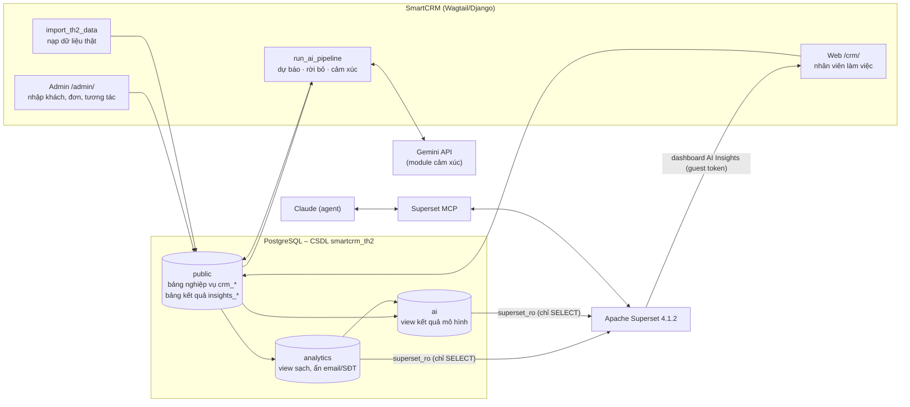
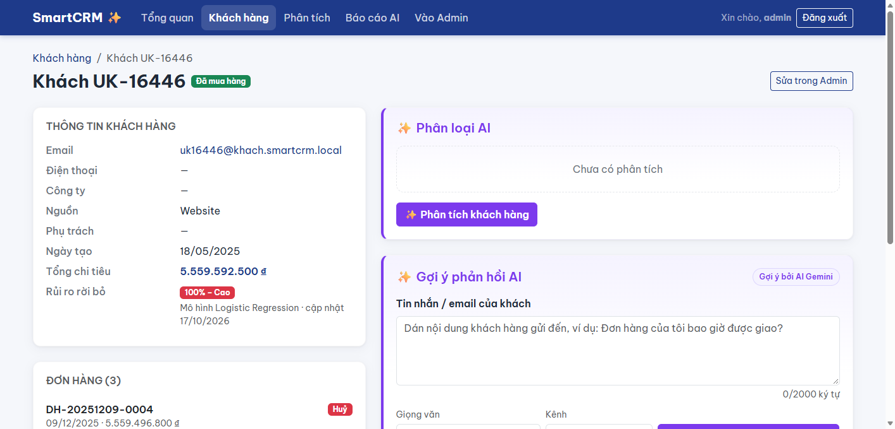
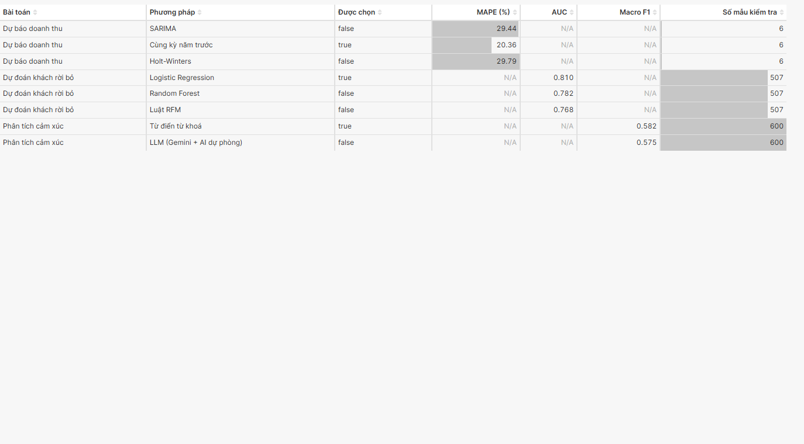
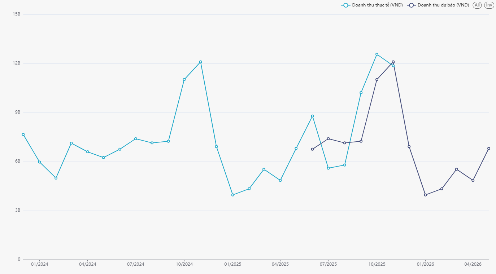
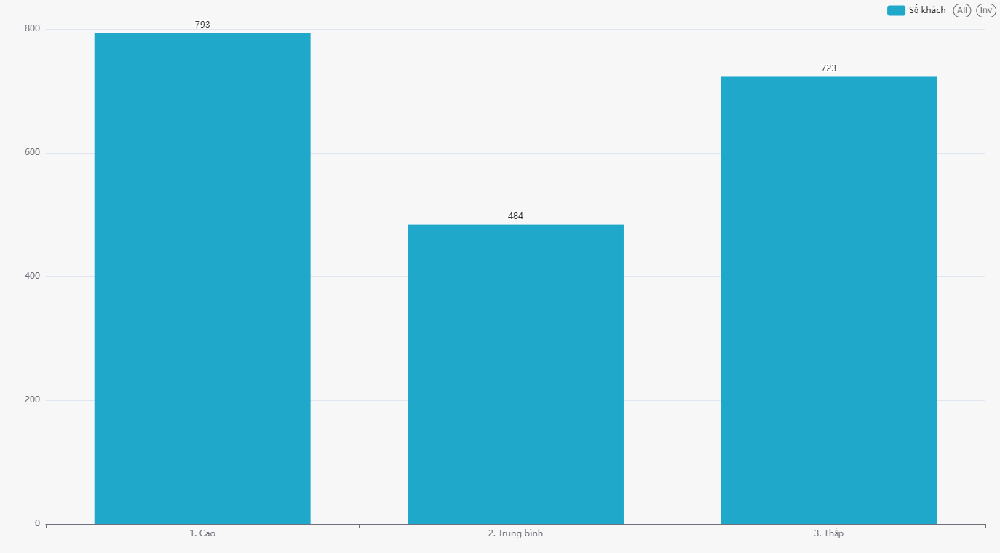
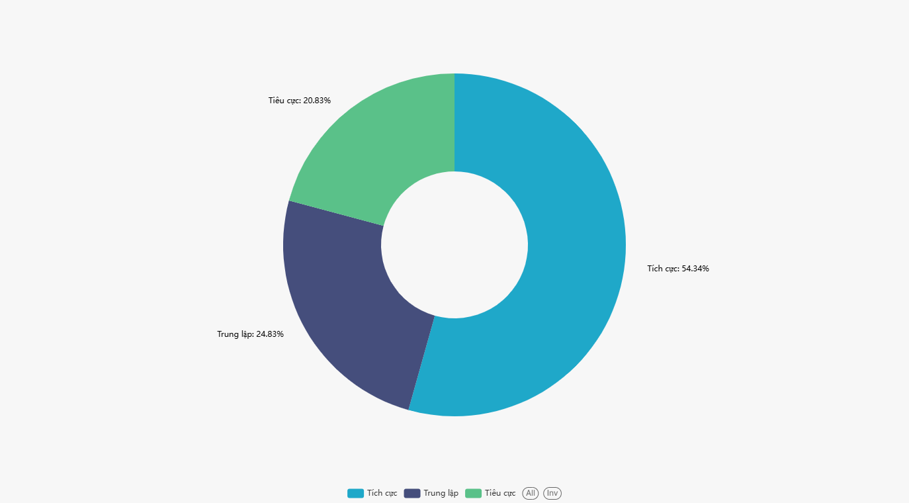

# BÁO CÁO TH2 – HỆ THỐNG PHÂN TÍCH DỮ LIỆU THÔNG MINH TÍCH HỢP AI VÀ APACHE SUPERSET (MCP)

**Đề tài:** Phân tích dữ liệu thông minh cho SmartCRM với AI và Apache Superset MCP · **Nhóm 3** – Trường Đại học Thủy Lợi ·
Môn: Hệ thống kinh doanh

## Mục lục

1. [Tổng quan đề tài, mục tiêu, thành viên và phân công](#1-tổng-quan-đề-tài-mục-tiêu-thành-viên-và-phân-công)
2. Kiến trúc và luồng dữ liệu (checklist 01)
3. Mô hình AI (checklist 02, 06) – 3.1 Dự báo doanh thu · 3.2 Khách rời bỏ · 3.3 Cảm xúc tin nhắn
4. Apache Superset MCP (checklist 03)
5. Dashboard AI Insights (checklist 04)
6. Kiểm thử và đối chiếu số liệu (checklist 05)
7. Đề xuất mô hình và phương pháp mở rộng (checklist 06)
8. Hướng dẫn cài đặt
9. Kết luận, hạn chế, hướng phát triển
- Phụ lục A. Checklist ↔ bằng chứng

## 1. Tổng quan đề tài, mục tiêu, thành viên và phân công

**Bối cảnh.** SmartCRM là hệ thống quản lý khách hàng xây trên Wagtail CMS (Django) do nhóm phát triển: khách hàng, đơn
hàng, sản phẩm, lịch sử tương tác và các tính năng AI (gợi ý phản hồi, phân loại khách, báo cáo nhận định). TH1 đã đưa dữ
liệu SmartCRM lên Apache Superset và nhúng dashboard vào SmartCRM. **TH2 thêm tầng phân tích thông minh:** chạy các mô hình
AI trên dữ liệu bán hàng thật, lưu kết quả vào CSDL, cho trợ lý AI (Claude) dựng biểu đồ qua **Superset MCP**, và đưa kết
quả AI trở lại SmartCRM (dashboard nhúng + điểm rủi ro trên trang khách).

**Mục tiêu.**
1. Kiến trúc dữ liệu SmartCRM → PostgreSQL → Superset có tầng kết quả AI riêng, quyền chỉ đọc.
2. Ba bài toán AI, mỗi bài so sánh 2 – 3 phương pháp trên cùng tập kiểm tra: **dự báo doanh thu**, **khách rời bỏ**,
   **cảm xúc tin nhắn**.
3. Kết nối Superset qua MCP để AI tạo biểu đồ bằng câu lệnh tiếng Việt, với tài khoản quyền hạn chế.
4. Dashboard 4 tab "SmartCRM – AI Insights" nhúng trong SmartCRM.
5. Báo cáo kỹ thuật, đánh giá mô hình, đối chiếu số liệu tự động; đề xuất mô hình mở rộng.

**Kết quả chính.**

| Hạng mục | Kết quả |
|---|---|
| Dữ liệu | 2.000 khách, 14.680 đơn (255.715 dòng), 4.424 sản phẩm, 24 tháng (12/2023 – 11/2025); 3.000 nhận xét tiếng Việt có nhãn |
| Dự báo doanh thu | Chọn *Cùng kỳ năm trước* – MAPE 20,4%; dự báo 6 tháng tới ≈ 32,4 tỷ ₫ |
| Khách rời bỏ | Chọn *Logistic Regression* – AUC 0,810; 793 khách rủi ro cao, trong đó 89 khách vẫn đang mua → danh sách chăm sóc |
| Cảm xúc | Chọn *Từ điển từ khoá* – Macro F1 0,582; LLM bắt câu tiêu cực 89,6% |
| Superset MCP | 16 biểu đồ tạo qua MCP bằng tài khoản `mcp_agent` (không ghi được dữ liệu, không thấy CSDL TH1) |
| Dashboard | 4 tab, 16 biểu đồ, 3 bộ lọc, nhúng tại `/crm/analytics/?tab=ai`; 15/15 biểu đồ khớp SQL |
| Kiểm thử | 161 test tự động qua; `verify_ai_results` 40/40 mục khớp |

**Thành viên và phân công.**

| # | Thành viên | Vai trò | Checklist | Sản phẩm chính |
|---|---|---|---|---|
| 1 | **Tùng** (nhóm trưởng) | Kiến trúc, dữ liệu thật, Superset MCP, module cảm xúc, tích hợp | 01, 03, 06 (+ 02, 05) | app `insights`, `import_th2_data`, `run_ai_pipeline`, schema `ai`, `sentiment.py`, cấu hình MCP, mục 2, 3.3, 4, 7 |
| 2 | **Ngọc Anh** | Module dự báo doanh thu | 02, 05, 06 | `forecast.py`, test, mục 3.1 |
| 3 | **Thái Anh** | Module khách rời bỏ + hiển thị trên trang khách | 02, 05, 06 | `churn.py`, `_churn_risk.html`, test, mục 3.2 |
| 4 | **Hoàng Anh** | Dashboard AI Insights qua MCP | 03, 04 | 12 biểu đồ 3 tab, `layout_th2.py`, file xuất dashboard, mục 4.5, 5 |
| 5 | **Hoàng Hưng** | Kiểm thử, đối chiếu, báo cáo, video | 05 | `verify_ai_results`, test, mục 6, báo cáo gộp, kịch bản video |

Luật chung của nhóm (tên bảng, cột, phương pháp, chỉ số): `docs/th2/HOP_DONG_DU_LIEU.md`.

## 2. Kiến trúc và luồng dữ liệu (checklist 01)

*Người viết: Tùng*

### 2.1. Tổng quan

Module phân tích dữ liệu thông minh được xây trên hệ thống CRM **SmartCRM** (Wagtail CMS / Django) của nhóm. Dữ liệu
nghiệp vụ nằm trong PostgreSQL; các mô hình AI đọc dữ liệu thô, ghi kết quả ngược vào CSDL; Apache Superset đọc kết
quả qua một tầng view chỉ đọc và hiển thị thành dashboard, được nhúng lại vào giao diện SmartCRM. Superset MCP cho phép
trợ lý AI (Claude) tạo dataset và biểu đồ bằng câu lệnh tiếng Việt.



### 2.2. Các tầng

| Tầng | Thành phần | Vai trò |
|---|---|---|
| Nguồn | SmartCRM: Admin, web `/crm/`, lệnh `import_th2_data` | Nhập và lưu dữ liệu nghiệp vụ: khách hàng, đơn hàng, dòng sản phẩm, tương tác |
| CSDL trung tâm | PostgreSQL 16, CSDL `smartcrm_th2` | Nơi duy nhất chứa dữ liệu; tách riêng khỏi CSDL `smartcrm` của TH1 |
| Xử lý AI | App `insights`, lệnh `run_ai_pipeline` | Đọc dữ liệu thô qua Django ORM, chạy mô hình, ghi kết quả vào bảng `insights_*` |
| Phục vụ phân tích | Schema `analytics` (7 view, từ TH1) và `ai` (4 view, TH2) | Lớp chỉ đọc, đã làm sạch và ẩn dữ liệu cá nhân; chỉ lấy batch mô hình mới nhất |
| Trực quan hoá | Apache Superset, Superset MCP | Dataset, biểu đồ, dashboard "SmartCRM – AI Insights" |
| Người dùng | Trang Phân tích `/crm/analytics/`, trang chi tiết khách | Nhân viên xem dashboard và mức rủi ro rời bỏ ngay trong SmartCRM |

### 2.3. Dữ liệu

#### Bán hàng – Online Retail II
- **Nguồn:** UCI Machine Learning Repository, *Online Retail II* (Chen, 2012, https://doi.org/10.24432/C5CG6D),
  giấy phép **CC BY 4.0**. Giao dịch thật của một cửa hàng bán lẻ trực tuyến ở Anh, 01/12/2009 – 09/12/2011,
  1.067.371 dòng, 5.942 mã khách.
- **Xử lý** (lệnh `python manage.py import_th2_data`):

| Bước | Quy ước | Lý do |
|---|---|---|
| Bỏ trùng | Hai sheet của file trùng 1.088 hoá đơn (01–09/12/2010); bỏ bản ở sheet đầu | Tránh đếm doanh thu hai lần |
| Lọc | Bỏ dòng không có mã khách, giá ≤ 0, mã hàng không bắt đầu bằng chữ số (phí ship POST, chiết khấu D, phí ngân hàng…) | Chỉ giữ hàng hoá thật gắn với khách |
| Lấy mẫu | 2.000 khách, `random_state=42` | Đủ lớn cho học máy, nạp nhanh; mọi máy ra cùng một bộ |
| Thời gian | Dời **+14 năm** (12/2009 → 12/2023, 12/2011 → 12/2025), giờ gốc coi là giờ Việt Nam | Giữ nguyên tháng nên giữ mùa vụ; dữ liệu gần hiện tại |
| Tiền tệ | 1 GBP = 33.000 VNĐ (tỉ giá cố định), làm tròn đến đồng | Thống nhất đơn vị VNĐ với SmartCRM |
| Trạng thái đơn | Hoá đơn mã `C…` → **Huỷ**, còn lại → **Hoàn thành** | Theo quy ước của bộ dữ liệu (mã C = hoá đơn huỷ) |
| Dòng sản phẩm | Gộp dòng cùng hoá đơn, cùng mã hàng, cùng đơn giá | Giữ đúng doanh thu |
| Sản phẩm | `track_stock=False` | Bộ dữ liệu không có tồn kho |
| Khách hàng | Tên `Khách UK-<mã>`, email `uk<mã>@khach.smartcrm.local`, nguồn Website; quốc gia ghi trong ghi chú đơn | Bộ dữ liệu đã ẩn danh, không có tên thật |
| Trạng thái khách | Không mua ≥ 180 ngày tính đến ngày tham chiếu → **Đã rời bỏ** | Cùng định nghĩa với mô hình rời bỏ |

- **Kết quả nạp:** 2.000 khách, 14.680 đơn (2.370 đơn huỷ), 255.715 dòng sản phẩm, 4.424 sản phẩm;
  thời gian 01/12/2023 – 09/12/2025; **ngày tham chiếu 09/12/2025**; doanh thu đơn Hoàn thành
  **186.513.155.070 VNĐ**; 24 tháng trọn vẹn (12/2023 – 11/2025); 805 khách Đã rời bỏ.
- ⚠️ **Hạn chế:** trong bộ dữ liệu, hoá đơn `C…` là hoá đơn **huỷ của một hoá đơn đã bán trước đó** (2.370 hoá đơn,
  10.235.964.090 VNĐ ≈ 5,5% doanh thu). Nhóm giữ quy ước của SmartCRM: doanh thu = tổng đơn Hoàn thành, **không trừ** phần
  huỷ này, nên doanh thu là doanh thu gộp (gross); doanh thu thuần ≈ 176,3 tỷ. Quy ước giống nhau ở mọi nơi (trang
  Tổng quan, view, mô hình, dashboard) nên các số vẫn khớp nhau.

#### Văn bản cảm xúc – nhận xét sản phẩm tiếng Việt
- **Nguồn:** Hugging Face `anotherpolarbear/vietnamese-sentiment-analysis`, giấy phép **MIT** theo trang dữ liệu:
  10.010 nhận xét điện thoại tiếng Việt, mỗi nhận xét chấm 1–5 sao. Nội dung giống các bộ đánh giá sản phẩm trên trang
  bán lẻ điện thoại; trang dữ liệu không ghi nguồn gốc, nên nhóm chỉ dùng cho mục đích học tập.
- **Nhãn:** 1–2 sao = **Tiêu cực**, 3 sao = **Trung lập**, 4–5 sao = **Tích cực**.
- **Xử lý:** bỏ câu rỗng và câu trùng; lấy mẫu phân tầng **3.000 câu** (`random_state=42`, giữ tỉ lệ nhãn: 1.898 tích
  cực, 721 tiêu cực, 381 trung lập); mỗi câu thành một bản ghi *Lịch sử tương tác* gắn **ngẫu nhiên** cho một khách đã
  mua, thời điểm trong khoảng khách đó còn mua hàng; kênh Email/Chat/Điện thoại/Trực tiếp theo tỉ lệ 40/40/10/10.
  Nhãn đúng lưu ở bảng `SentimentLabel`.
- ⚠️ **Hạn chế:** việc gắn nhận xét vào khách là **nhân tạo** (hai bộ dữ liệu khác nguồn). Kết quả cảm xúc theo khách
  hoặc theo kênh chỉ mang tính minh hoạ; còn độ chính xác của mô hình cảm xúc vẫn có giá trị vì so với nhãn thật.

### 2.4. Bảng kết quả AI và tầng view

*(Chi tiết cột: `docs/th2/HOP_DONG_DU_LIEU.md` mục 4 và 7.)*

| Bảng (app `insights`) | Nội dung | View cho Superset |
|---|---|---|
| `ModelRun` | Mỗi phương pháp của mỗi module trong một lần chạy: chỉ số đánh giá, tham số, trạng thái, phương pháp được chọn | `ai.model_run` |
| `RevenueForecast` | Doanh thu tháng: lịch sử, kiểm tra lại 6 tháng, dự báo 6 tháng tới kèm khoảng tin cậy 95% | `ai.revenue_forecast` |
| `ChurnScore` | Xác suất rời bỏ và mức rủi ro của từng khách | `ai.churn_score` |
| `SentimentLabel`, `SentimentResult` | Nhãn đúng và nhãn dự đoán của từng tin nhắn | `ai.interaction_sentiment` |

Mỗi view chỉ lấy **batch thành công mới nhất** của từng module, nên chạy lại mô hình là dashboard tự cập nhật. Lệnh
`seed_ai_demo` ghi kết quả giả (batch `demo`) để dựng dashboard trước khi có mô hình thật; batch thật luôn được ưu tiên.

### 2.5. Bảo mật

| Tài khoản | Dùng bởi | Quyền | Không làm được |
|---|---|---|---|
| `smartcrm` (PostgreSQL) | Wagtail, lệnh `import_th2_data`, `run_ai_pipeline` | Chủ CSDL `smartcrm_th2` | – (hạn chế còn lại, xem dưới) |
| `superset_ro` (PostgreSQL) | Superset đọc dữ liệu | `SELECT` trên schema `analytics`, `ai`; phiên luôn read-only; truy vấn tối đa 30 giây; tối đa 10 kết nối | Đọc bảng gốc `crm_*`, `insights_*`, `auth_user`; ghi bất kỳ dữ liệu nào |
| `mcp_agent` (Superset) | Claude qua Superset MCP | Vai trò `Gamma` + `sql_lab` + `TH2_MCP` (chỉ kết nối "SmartCRM TH2 (chỉ đọc)") | Truy cập CSDL TH1; chạy lệnh ghi (DML bị tắt); tạo kết nối CSDL; quản lý người dùng |
| `admin` (Superset) | Script `bootstrap_th2.py`, máy chủ Wagtail xin guest token | Quản trị | Không đưa cho trình duyệt hay agent |
| Guest token | Trình duyệt nhân viên xem dashboard nhúng | Chỉ xem đúng dashboard được cấp, hết hạn sau 5 phút | Mở SQL Lab, dataset, dashboard khác |

Các biện pháp khác:
- Mọi mật khẩu, khoá API nằm trong `.env` (không commit); mật khẩu `mcp_agent` nằm trong `tools/superset-mcp/.env` ngoài repo.
- View `analytics`, `ai` bỏ email, số điện thoại, nội dung tin nhắn; dashboard chỉ thấy tên hiển thị đã ẩn danh.
- Dữ liệu thật đều là bộ công khai đã ẩn danh; thư mục `data/` không commit.
- Cổng PostgreSQL và Superset chỉ mở trên `127.0.0.1`; Superset chỉ cho SmartCRM (`127.0.0.1:8000`, `localhost:8000`) đặt
  dashboard trong iframe.
- Lệnh `import_th2_data` từ chối chạy trên CSDL không có đuôi `_th2`, tránh ghi đè dữ liệu TH1.

Hạn chế còn lại (môi trường học tập): Wagtail dùng tài khoản chủ CSDL; kết nối nội bộ Docker không bật SSL; công cụ đăng nhập
của MCP cộng đồng trả access token cho agent. Triển khai thật nên tách tài khoản ứng dụng, bật `sslmode=require` và dùng MCP
chính thức của Superset 6.x với JWT.

### 2.6. SmartCRM hiển thị kết quả AI

Trang **Phân tích** (`/crm/analytics/`) có 2 tab: **AI Insights** (dashboard `smartcrm-ai-insights` của TH2) và **Phân tích
kinh doanh** (dashboard của TH1). Dashboard được nhúng bằng Superset Embedded SDK với guest token do máy chủ Wagtail xin
cho từng nhân viên đã đăng nhập; danh sách tab đặt trong `SUPERSET_DASHBOARDS` (settings).


Ngoài dashboard, kết quả AI còn đi thẳng vào thao tác hằng ngày của nhân viên:
- Trang **chi tiết khách** (`/crm/customers/<id>/`) có dòng **Rủi ro rời bỏ** – ví dụ "100% – Cao · Mô hình Logistic
  Regression · cập nhật 17/10/2026" – đọc từ `ChurnScore` của phương pháp được chọn trong batch rời bỏ mới nhất, ưu tiên
  batch thật hơn batch `demo` (`insights/display.py`, 1 truy vấn). Khách chưa có điểm hiện "Chưa có dự đoán".
- Admin có menu **Kết quả AI** (chỉ xem) cho từng lần chạy mô hình: chỉ số, tham số, ghi chú.



## 3. Mô hình AI (checklist 02, 06)

Ba bài toán, mỗi bài so sánh nhiều phương pháp trên cùng tập kiểm tra; số liệu lấy từ `ai.model_run` của batch ghi ở đầu mỗi mục.

### 3.1. Mô hình dự báo doanh thu tháng (checklist 02, 06)

#### 1. Bài toán và câu hỏi kinh doanh

Module dự báo trả lời câu hỏi: trong sáu tháng tới, tổng doanh thu mỗi tháng của
shop có thể là bao nhiêu và khoảng dao động hợp lý là bao nhiêu? Kết quả dành cho
người quản lý và nhóm phân tích để lập kế hoạch bán hàng, dòng tiền và tồn kho.
Module chỉ dự báo tổng doanh thu theo tháng, không dự báo theo từng sản phẩm hoặc
từng khách hàng.

#### 2. Dữ liệu

Nguồn dữ liệu là Online Retail II. Dữ liệu được lấy mẫu 2.000 khách với
`random_state=42`, dời thời gian thêm 14 năm và quy đổi theo tỷ giá cố định
`1 GBP = 33.000 VNĐ`. Hóa đơn có mã bắt đầu bằng `C` được xem là đơn huỷ và
không tính doanh thu; doanh thu là tổng `quantity × unit_price` của đơn hoàn
thành theo quy ước TH1.

Sau khi nạp có 14.680 đơn, trong đó 2.370 đơn huỷ, 255.715 dòng sản phẩm và
4.424 sản phẩm. Ngày tham chiếu là 09/12/2025. Chuỗi dùng cho mô hình gồm 24
tháng trọn vẹn từ 12/2023 đến 11/2025, các tháng không có đơn được điền bằng 0.
Tổng chuỗi 24 tháng dùng trong mô hình là 177.385.266.960 VNĐ. Doanh thu đơn
hoàn thành toàn bộ dữ liệu trước khi loại tháng chưa trọn vẹn là
186.513.155.070 VNĐ.

#### 3. Phương pháp

- **Seasonal naive:** dự báo tháng kế tiếp bằng doanh thu của cùng tháng năm
  trước (độ trễ 12 tháng). Khoảng tin cậy 95% được tính bằng dự báo cộng/trừ
  `1,96 × độ lệch chuẩn sai số` trên phần huấn luyện.
- **Holt-Winters:** dùng `statsmodels.ExponentialSmoothing` với xu hướng cộng,
  mùa vụ cộng, chu kỳ 12 tháng và `initialization_method="estimated"`. Khoảng
  tin cậy dùng độ lệch sai số giữa fitted values và dữ liệu huấn luyện. Mô hình
  luôn thử bản có mùa vụ trước; khi backtest chỉ có 18 tháng (chưa đủ 2 chu kỳ),
  statsmodels báo không tính được hệ số mùa vụ ban đầu nên dùng bản không mùa vụ
  – ghi trong `notes` và `params.model` của lần chạy. Dự báo 6 tháng tới (24 tháng
  huấn luyện) dùng bản có mùa vụ.
- **SARIMA:** dùng `SARIMAX` (tham số mặc định của statsmodels) với
  `order=(1,1,1)` và `seasonal_order=(0,1,1,12)` khi có đủ 24 tháng; chuỗi ngắn hơn
  thử `(0,1,0,12)` rồi `(1,1,1)` không mùa vụ. Cấu hình nào lỗi hoặc cho dự báo
  **phân kỳ** (vượt 3 lần doanh thu tháng cao nhất) thì bị loại và chuyển cấu hình
  sau; cấu hình thực dùng ghi trong `params` và `notes`. Khoảng tin cậy lấy từ
  `get_forecast().conf_int(alpha=0.05)`. Các giá trị âm được cắt về 0.

#### 4. Cách đánh giá

Sáu tháng cuối được giữ làm tập kiểm tra; 18 tháng đầu dùng huấn luyện. Mỗi
phương pháp dự báo sáu tháng kiểm tra rồi được huấn luyện lại trên toàn bộ 24
tháng để dự báo sáu tháng tiếp theo. MAE là trung bình số tiền dự báo lệch bao
nhiêu đồng mỗi tháng. RMSE cũng đo độ lệch nhưng phạt mạnh hơn các sai số lớn.
MAPE là trung bình phần trăm lệch; các tháng có doanh thu thực tế bằng 0 được
bỏ qua khi tính MAPE.

#### 5. Kết quả

Mã batch: `20261017-072049`. Chỉ số tính trên dự báo đã làm tròn đến đồng – đúng giá
trị lưu trong `RevenueForecast`, nên tính lại được từ các dòng `backtest`.

| Phương pháp | MAE (VNĐ) | RMSE (VNĐ) | MAPE (%) | Huấn luyện | Kiểm tra | Được chọn |
|---|---:|---:|---:|---:|---:|---|
| seasonal_naive | 1.657.659.575 | 1.847.696.404 | 20,3593 | 18 | 6 | Có |
| sarima | 2.792.891.919 | 3.176.278.363 | 29,4439 | 18 | 6 | Không |
| holt_winters | 2.905.651.300 | 3.290.414.554 | 29,7908 | 18 | 6 | Không |

Mỗi phương pháp thành công và ghi đủ 18 dòng `history`, 6 dòng `backtest` và
6 dòng `future`. `seasonal_naive` được chọn vì có MAPE nhỏ nhất.

Chi tiết 6 tháng kiểm tra (tỷ VNĐ):

| Tháng | Thực tế | seasonal_naive | holt_winters | sarima |
|---|---:|---:|---:|---:|
| 06/2025 | 8,79 | 6,75 | 6,89 | 7,82 |
| 07/2025 | 5,59 | 7,40 | 6,98 | 7,20 |
| 08/2025 | 5,79 | 7,14 | 7,07 | 7,58 |
| 09/2025 | 10,21 | 7,24 | 7,16 | 7,35 |
| 10/2025 | 12,56 | 11,01 | 7,26 | 7,49 |
| 11/2025 | 11,86 | 12,10 | 7,35 | 7,40 |

Ghi chú của lần chạy: Holt-Winters backtest dùng bản không mùa vụ (18 tháng); SARIMA
backtest loại cấu hình `(1,1,1)×(0,1,0,12)` (lỗi LU decomposition) và dùng `(1,1,1)`
không mùa vụ. Vì vậy hai mô hình này dự báo gần như phẳng (≈ 7–7,5 tỷ) và bỏ lỡ đỉnh
tháng 10 – 11.

**Dự báo 6 tháng tới** (phương pháp được chọn, tỷ VNĐ, khoảng tin cậy 95%):
12/2025 **6,92** (3,64 – 10,19) · 01/2026 3,96 (0,68 – 7,23) · 02/2026 4,33 ·
03/2026 5,53 · 04/2026 4,85 · 05/2026 6,80 – tổng ≈ 32,4 tỷ.

#### 6. Kết luận

Với batch này, `seasonal_naive` là phương pháp phù hợp nhất trong ba phương
pháp theo tiêu chí MAPE. Kết quả cho thấy việc lặp lại doanh thu cùng tháng của
năm trước phù hợp hơn Holt-Winters và SARIMA trên chuỗi 24 tháng hiện có: với 18 tháng
huấn luyện, hai mô hình thống kê không học được mùa vụ nên bỏ lỡ đỉnh cuối năm.

#### 7. Hạn chế

- Dữ liệu là của một shop ở Anh, đã được dời thời gian và đổi tiền để phục vụ
  bài thực hành; đây không phải dữ liệu vận hành hiện tại của shop tại Việt Nam.
- Số tháng quan sát ít (24 tháng), nên việc đánh giá mùa vụ và độ ổn định của
  mô hình còn hạn chế.
- Chỉ dự báo tổng doanh thu theo tháng, chưa dự báo theo sản phẩm, nhóm sản
  phẩm, khách hàng hoặc kênh bán.
- Khoảng tin cậy là ước lượng thống kê, không phải cam kết doanh thu thực tế.

#### 8. Cách chạy lại

```powershell
.venv\Scripts\Activate.ps1
python manage.py run_ai_pipeline --only forecast
python manage.py test
```

Kết quả được ghi vào `ModelRun` và `RevenueForecast` trong batch mới. View
`ai.revenue_forecast` sẽ tự lấy batch thành công mới nhất sau khi tầng view
Superset đã được cài đặt.

### 3.2. Mô hình dự đoán khách hàng rời bỏ (checklist 02, 06)

*Người viết: Thái Anh · Code: `insights/pipeline/churn.py`, hiển thị: `crm/templates/crm/_churn_risk.html`, `insights/display.py` · Batch: **20261017-072049***

#### 1. Bài toán và câu hỏi kinh doanh

Module ước tính khách hàng nào có nguy cơ không quay lại mua hàng trong 180 ngày tiếp theo. Nhân viên chăm sóc khách hàng có thể ưu tiên liên hệ nhóm rủi ro cao, kiểm tra trải nghiệm gần đây và đề xuất hỗ trợ phù hợp. Điểm rủi ro là tín hiệu tham khảo, không tự động đổi trạng thái khách hàng.

#### 2. Dữ liệu

Nguồn bán hàng theo hợp đồng TH2 là Online Retail II, lấy mẫu 2.000 khách có mã khách, dời thời gian thêm 14 năm và quy đổi theo tỷ giá cố định 33.000 VNĐ/GBP. Theo số liệu nạp ghi trong [báo cáo kiến trúc](01_kien_truc.md), dữ liệu hiện có 14.680 đơn (2.370 đơn huỷ), 255.715 dòng sản phẩm và 4.424 sản phẩm; thời gian giao dịch từ 01/12/2023 đến 09/12/2025. Có 24 tháng trọn vẹn từ 12/2023 đến 11/2025. Ngày tham chiếu là **09/12/2025**. Báo cáo kiến trúc ghi nhận 805 khách có trạng thái CRM “Đã rời bỏ”; con số này là trạng thái nghiệp vụ, không thay thế số nhãn churn của tập huấn luyện.

Cutoff bằng ngày tham chiếu trừ 180 ngày. Tập huấn luyện gồm khách có ít nhất một đơn hoàn thành trước cutoff. Nhãn bằng 1 nếu khách không có đơn hoàn thành trong khoảng `(cutoff, ngày tham chiếu]`, bằng 0 nếu có. Đặc trưng chỉ tính từ dữ liệu **đến hết ngày cutoff** (12/06/2025), nhãn xét các đơn **sau ngày cutoff** đến hết 09/12/2025 – mỗi đơn thuộc đúng một phía, không nhìn trước tương lai. Tập có nhãn gồm **1.690 khách**, trong đó **807 khách rời bỏ (47,75%)** – hai lớp gần cân bằng. Sau khi chọn mô hình, điểm rủi ro được chấm cho **2.000 khách** có ít nhất một đơn hoàn thành đến ngày tham chiếu.

#### 3. Phương pháp

- **Luật RFM (`rfm_rule`):** dùng thứ hạng phần trăm của `recency_days`; khách càng lâu chưa mua thì điểm càng cao. Đây là quy tắc không huấn luyện mô hình.
- **Logistic Regression – hồi quy logistic (`logistic_regression`):** chuẩn hoá đặc trưng bằng `StandardScaler`, dùng `class_weight="balanced"` và `max_iter=1000`.
- **Random Forest – rừng ngẫu nhiên (`random_forest`):** dùng 300 cây, `class_weight="balanced"` và `random_state=42`. Năm đặc trưng quan trọng nhất sẽ được ghi trong kết quả batch.

Cả ba phương pháp dùng các đặc trưng recency, frequency, monetary, average order value, tenure, số đơn 90 ngày gần nhất, số đơn huỷ, số sản phẩm khác nhau và số tương tác.

#### 4. Cách đánh giá

Dữ liệu được chia ngẫu nhiên thành 70% huấn luyện và 30% kiểm tra, phân tầng theo nhãn, `random_state=42`. AUC đo khả năng xếp khách có nguy cơ cao hơn khách không rời bỏ; 0,5 tương đương đoán ngẫu nhiên, 1 là phân biệt hoàn hảo. Precision trả lời: trong số khách mô hình báo có nguy cơ, bao nhiêu phần trăm thật sự rời bỏ. Recall trả lời: trong số khách thật sự rời bỏ, mô hình phát hiện được bao nhiêu phần trăm. Precision, recall, F1 và accuracy dùng ngưỡng xác suất 0,5. Phương pháp có AUC cao nhất được chọn.

#### 5. Kết quả

Mã batch: **`20261017-072049`** (số lấy từ `ai.model_run`). Tập huấn luyện 1.183 khách, tập kiểm tra 507 khách.

| Phương pháp | AUC | Precision | Recall | F1 | Accuracy | n_train | n_test |
|---|---:|---:|---:|---:|---:|---:|---:|
| Luật RFM | 0,768 | 66,9% | 70,3% | 0,686 | 69,2% | 1.183 | 507 |
| **Logistic Regression ★** | **0,810** | **69,7%** | 75,2% | **0,724** | **72,6%** | 1.183 | 507 |
| Random Forest | 0,782 | 67,3% | **76,4%** | 0,716 | 71,0% | 1.183 | 507 |

- **Tỷ lệ rời bỏ của tập:** 47,73% (`churn_rate` trên toàn bộ 1.690 khách có nhãn).
- **Ma trận nhầm lẫn của phương pháp được chọn – Logistic Regression** (hàng = nhãn thật, cột = dự đoán, 507 khách kiểm tra):

  |  | Dự đoán không rời bỏ | Dự đoán rời bỏ |
  |---|---:|---:|
  | Thật sự không rời bỏ | 186 (tn) | 79 (fp – gọi nhầm) |
  | Thật sự rời bỏ | 60 (fn – bỏ sót) | 182 (tp) |

- **Top đặc trưng quan trọng của Random Forest:** `recency_days` 0,209 · `monetary` 0,167 · `distinct_products` 0,139 · `avg_order_value` 0,121 · `tenure_days` 0,120.
- **Số khách theo mức rủi ro (Logistic Regression, 2.000 khách):** Cao **793** · Trung bình **484** · Thấp **723**.
- **Trang khách:** ví dụ Khách UK-16446 hiện "100% – Cao · Mô hình Logistic Regression".

#### 6. Kết luận

Chọn **Logistic Regression** vì có AUC cao nhất (0,810), đồng thời F1 và accuracy cũng cao nhất. Ba phương pháp chênh nhau không nhiều (AUC 0,77 – 0,81) vì tín hiệu mạnh nhất là *bao lâu rồi khách chưa mua* – luật RFM chỉ dựa vào recency cũng đạt 0,768. Random Forest có recall cao nhất (bắt được 76% khách rời bỏ thật) – phù hợp nếu cửa hàng chấp nhận gọi nhầm nhiều hơn để không bỏ sót.

Gợi ý cho nhân viên: ưu tiên rà soát nhóm rủi ro cao (793 khách), trước hết là khách có tổng chi tiêu lớn; xem lịch sử mua hàng và tương tác, sau đó liên hệ để hỏi nhu cầu hoặc xử lý vấn đề còn tồn đọng. Nhóm trung bình có thể nhận email nhắc sản phẩm từng mua. Không gửi cùng một nội dung tự động cho mọi khách.

#### 7. Hạn chế

Mốc 180 ngày là quy ước của nhóm, không khẳng định mọi khách đều xem khoảng thời gian này là rời bỏ. Dữ liệu bán hàng lấy từ cửa hàng ở nước ngoài, đã dịch chuyển thời gian và quy đổi tiền tệ nên có thể khác hành vi khách hàng thực tế tại Việt Nam. Tương tác văn bản trong dự án được gắn nhân tạo theo hợp đồng TH2. Kết quả phụ thuộc vào số lượng và chất lượng dữ liệu, cần được nhân viên kiểm tra trước khi hành động.

#### 8. Cách chạy lại

```powershell
python manage.py run_ai_pipeline --only churn
```

Sau khi chạy, cập nhật bảng ở mục 5 bằng số của batch mới (lấy từ `ai.model_run`). Kiểm tra nhanh: `python manage.py test insights.tests.test_churn`.

### 3.3. Mô hình phân tích cảm xúc tin nhắn khách hàng (checklist 02, 06)

*Người viết: Tùng · Code: `insights/pipeline/sentiment.py`, `insights/pipeline/lexicon_vi.py` · Batch: **20261014-215419***

#### 1. Bài toán và câu hỏi kinh doanh

*Khách đang hài lòng hay bực bội? Kênh nào, tháng nào nhiều phản hồi tiêu cực?* Mỗi tin nhắn / nhận xét của khách được
gán một nhãn **Tích cực / Trung lập / Tiêu cực**. Nhân viên chăm sóc dùng kết quả để ưu tiên xử lý khách đang không hài
lòng; quản lý theo dõi xu hướng cảm xúc theo kênh và theo thời gian trên dashboard.

#### 2. Dữ liệu

| Hạng mục | Giá trị |
|---|---|
| Nguồn | 3.000 nhận xét điện thoại tiếng Việt (Hugging Face `anotherpolarbear/vietnamese-sentiment-analysis`, MIT), nạp thành *Lịch sử tương tác* |
| Nhãn đúng | Từ số sao người viết tự chấm: 1–2 sao = Tiêu cực, 3 = Trung lập, 4–5 = Tích cực |
| Tập đánh giá | **600 câu**, lấy mẫu phân tầng theo nhãn (`random_state=42`): 380 tích cực, 144 tiêu cực, 76 trung lập |
| Lý do lấy mẫu | Giới hạn số lượt gọi LLM miễn phí; **cả hai phương pháp chấm đúng cùng 600 câu** để so sánh công bằng |

#### 3. Phương pháp

| Phương pháp | Mô tả | Tham số chính |
|---|---|---|
| **Từ điển từ khoá** (`keyword`) | Chuẩn hoá chữ thường, bỏ dấu câu, tách từ; so khớp **tham lam cụm dài trước** ("nhanh hết pin" trước "nhanh") với 73 cụm tích cực và 72 cụm tiêu cực (có cả từ viết tắt: ok, ko, lag…). Từ phủ định ("không", "chưa", "ko"…) đứng trước tối đa 2 từ thì **đảo chiều** cụm sau ("không lag" → tích cực). Điểm = số cụm tích cực − tiêu cực; khen chê ngang nhau → trung lập | 73 / 72 cụm, 11 từ phủ định, cửa sổ phủ định 2 từ |
| **LLM** (`gemini`) | Gọi mô hình ngôn ngữ lớn qua dịch vụ AI sẵn có của SmartCRM (`GeminiCRMService`): Gemini, tự chuyển sang **AI dự phòng Groq (GPT-OSS 120B)** khi Gemini lỗi hoặc hết hạn mức. Gửi theo lô 20 câu, yêu cầu trả JSON có schema `{id, label, confidence}`, `temperature = 0` để kết quả ổn định. Câu AI không trả lời được tính là trung lập | `gemini-3.8-flash`, dự phòng Groq, 30 lượt gọi, lô 20 câu |

#### 4. Cách đánh giá

- So nhãn dự đoán với nhãn đúng trên 600 câu.
- **Accuracy** – tỉ lệ câu đoán đúng.
- **Macro F1** – trung bình F1 của 3 nhãn, **mỗi nhãn nặng như nhau**. Chọn chỉ số này vì dữ liệu lệch (63% tích cực): một
  mô hình đoán "tích cực" cho mọi câu đã đạt accuracy 63% nhưng macro F1 rất thấp.
- **F1 / Precision / Recall từng nhãn** và **ma trận nhầm lẫn** – xem mô hình hay nhầm ở đâu.
- **Thời gian xử lý mỗi câu** và **chi phí / hạn mức** – yếu tố triển khai thực tế.

#### 5. Kết quả

| Phương pháp | Accuracy | **Macro F1** | F1 Tích cực | F1 Trung lập | F1 Tiêu cực | Thời gian / câu |
|---|---|---|---|---|---|---|
| Từ điển từ khoá ★ | **0,688** | **0,582** | **0,844** | **0,293** | 0,610 | < 1 ms |
| LLM (Gemini + AI dự phòng) | 0,667 | 0,575 | 0,785 | 0,220 | **0,719** | ≈ 1.096 ms* |

\* Thời gian mỗi lô chia đều cho 20 câu, **gồm cả thời gian chờ thử lại** khi Gemini/Groq báo hết hạn mức; thời gian xử
lý thực của LLM thấp hơn con số này.

★ = phương pháp được chọn (`is_selected`, macro F1 cao nhất).

**Ma trận nhầm lẫn** (hàng = nhãn đúng, cột = nhãn dự đoán):

| Từ điển | → Tích cực | → Trung lập | → Tiêu cực | Recall |
|---|---|---|---|---|
| Tích cực (380) | **298** | 67 | 15 | 78,4% |
| Trung lập (76) | 15 | **33** | 28 | 43,4% |
| Tiêu cực (144) | 13 | 49 | **82** | 56,9% |
| *Precision* | *91,4%* | *22,1%* | *65,6%* | |

| LLM | → Tích cực | → Trung lập | → Tiêu cực | Recall |
|---|---|---|---|---|
| Tích cực (380) | **248** | 99 | 33 | 65,3% |
| Trung lập (76) | 0 | **23** | 53 | 30,3% |
| Tiêu cực (144) | 4 | 11 | **129** | **89,6%** |
| *Precision* | *98,4%* | *17,3%* | *60,0%* | |

#### 6. Kết luận

- **Tổng thể hai phương pháp ngang nhau** (macro F1 0,582 so với 0,575); từ điển được chọn theo quy tắc chỉ số cao nhất.
- **LLM bắt khách không hài lòng tốt hơn hẳn:** nhận ra **129/144 = 89,6%** nhận xét tiêu cực, từ điển chỉ 56,9%. Khi một tin
  nhắn được LLM gắn "tích cực" thì gần như chắc chắn đúng (precision 98,4%).
- **Từ điển nhanh và miễn phí** (dưới 1 ms/câu, không gọi mạng), phù hợp chấm toàn bộ tin nhắn hằng ngày.
- **Đề xuất triển khai:** dùng từ điển chấm mọi tin nhắn; tin nhắn từ điển chấm "tiêu cực" hoặc "trung lập" thì gửi thêm cho
  LLM xác nhận – giữ ưu điểm bắt tiêu cực của LLM mà giảm khoảng 55% số lượt gọi.

#### 7. Hạn chế

- **Nhãn từ số sao có nhiễu:** nhiều nhận xét 4–5 sao vẫn chứa than phiền ("máy mượt nhưng pin tụt nhanh"). LLM đọc nội dung
  nên xếp các câu này vào trung lập / tiêu cực – bị tính là sai dù hợp lý. Đọc thử 15 trong 99 câu "4–5 sao" bị LLM xếp
  trung lập: **14 câu là khen kèm chê hoặc câu hỏi** (ví dụ *"máy oke, nhưng cần khắc phục lỗi pin dưới 10% không cho bật
  đèn flash"*, *"Cho hỏi là đt mình xài đc 8 tháng rồi… pin còn 87% là sao vậy ad"*), chỉ 1 câu khen trọn vẹn. Nghĩa là
  độ chính xác thật của LLM cao hơn con số đo được.
- **Lớp trung lập khó và ít mẫu** (76 câu): cả hai phương pháp đều yếu (F1 0,22–0,29).
- **Hạn mức miễn phí:** trong lần chạy này Gemini báo **hết hạn mức (quota)**, phần lớn các lô do **Groq** trả lời, Groq cũng có
  lúc báo 429 nên phải chờ và thử lại – tổng thời gian chạy khoảng 11 phút cho 600 câu. Kết quả LLM vì vậy là của **Gemini kết
  hợp Groq**, chưa tách được riêng từng mô hình. Từ lần chạy sau, `params.batches_by_provider` ghi số lô mỗi nhà cung cấp trả
  lời; nên chạy lại khi hạn mức Gemini được làm mới để có số liệu riêng của Gemini.
- **Văn bản gắn nhân tạo:** nhận xét là của một bộ dữ liệu điện thoại, được gắn ngẫu nhiên cho khách của cửa hàng Online
  Retail II. Biểu đồ cảm xúc theo kênh / theo khách chỉ mang tính minh hoạ; độ chính xác mô hình thì vẫn đúng vì so với nhãn thật.
- **Từ điển tự xây dựng**, chưa phủ hết từ lóng, lỗi chính tả, câu mỉa mai.

#### 8. Cách chạy lại

```powershell
python manage.py run_ai_pipeline --only sentiment          # 600 câu, cả hai phương pháp
$env:SENTIMENT_SAMPLE = "0"; python manage.py run_ai_pipeline --only sentiment   # chấm hết 3.000 câu (tốn hạn mức)
python manage.py test insights.tests.test_sentiment
```

## 4. Apache Superset MCP (checklist 03)

*Người viết: Tùng (phần cài đặt, 4 biểu đồ tab Tổng quan) · Hoàng Anh (phần dựng dashboard – bổ sung ở cuối)*

### 4.1. MCP là gì và nhóm dùng như thế nào

**MCP (Model Context Protocol)** là giao thức để trợ lý AI gọi công cụ bên ngoài. **Superset MCP** biến các thao tác trên
Superset (liệt kê dataset, chạy SQL, tạo biểu đồ, dashboard) thành *công cụ* mà Claude gọi được. Người dùng chỉ cần gõ
yêu cầu bằng tiếng Việt, Claude tự chọn công cụ và tham số.

```
Người dùng ──câu lệnh tiếng Việt──▶ Claude ──gọi công cụ MCP──▶ superset-mcp ──REST API (JWT)──▶ Superset 4.1.2
                                                                  (tài khoản mcp_agent)            │ superset_ro
                                                                                                   ▼
                                                                                    PostgreSQL – view ai.* (chỉ đọc)
```

| Hạng mục | Lựa chọn |
|---|---|
| MCP server | `aptro/superset-mcp` (MIT), commit `b3dd425` (28/07/2025), 60 công cụ |
| Lý do chọn | MCP chính thức của Apache (`superset/mcp_service`) chỉ có từ Superset 6.x; nâng cấp có thể làm hỏng dashboard và trang nhúng của TH1. Bản cộng đồng gọi REST API, tác giả đã thử với 4.1.1 – nhóm kiểm chứng chạy được với 4.1.2 |
| Chạy ở đâu | Máy người dùng, thư mục `tools/superset-mcp` (ngoài repo), môi trường ảo riêng |
| Kết nối Claude | `.mcp.json` (Claude Code) hoặc `claude_desktop_config.json` (Claude Desktop) – hướng dẫn: `docs/th2/CAI_DAT_MCP.md` |

### 4.2. Phân quyền – MCP không dùng tài khoản admin

| Lớp | Biện pháp | Kiểm chứng |
|---|---|---|
| Superset | Tài khoản `mcp_agent`, vai trò `Gamma` + `sql_lab` + `TH2_MCP` (chỉ `database_access` trên "SmartCRM TH2 (chỉ đọc)") | Chỉ thấy 1 database, 4 dataset `ai.*`; truy vấn CSDL TH1 bị từ chối "database … was not found" |
| Kết nối Superset | *Allow DML* tắt | `DELETE FROM ai.model_run` → **DML_NOT_ALLOWED_ERROR** |
| PostgreSQL | Kết nối bằng `superset_ro`: chỉ `SELECT` trên schema `analytics`, `ai`; phiên read-only; timeout 30 giây | `SELECT … FROM crm_customer` → *relation does not exist* (không thấy bảng gốc có email/SĐT) |
| Bí mật | Mật khẩu `mcp_agent` chỉ nằm trong `tools/superset-mcp/.env` trên máy, không vào repo | – |

Hạn chế: công cụ đăng nhập của `aptro/superset-mcp` trả access token (hạn ngắn) về cho Claude trong kết quả; token lưu ở
file `.superset_token` cạnh server. Chấp nhận được trên máy cá nhân; triển khai thật nên dùng MCP chính thức với JWT.

### 4.3. Kiểm thử gọi công cụ (14/10/2026)

| # | Công cụ | Tham số | Kết quả |
|---|---|---|---|
| 1 | `superset_auth_authenticate_user` | (đọc từ `.env`) | Successfully authenticated |
| 2 | `superset_database_list` | – | `[(2, 'SmartCRM TH2 (chỉ đọc)')]` |
| 3 | `superset_dataset_list` | – | 4 dataset `ai.model_run`, `ai.revenue_forecast`, `ai.churn_score`, `ai.interaction_sentiment` |
| 4 | `superset_sqllab_execute_query` | `SELECT module, method, is_selected FROM ai.model_run` | status success, 8 dòng |
| 5 | `superset_sqllab_execute_query` | `DELETE FROM ai.model_run` | **Bị từ chối** – DML_NOT_ALLOWED_ERROR |
| 6 | `superset_sqllab_execute_query` | `SELECT count(*) FROM crm_customer` | **Bị từ chối** – relation does not exist |
| 7 | `superset_sqllab_execute_query` | `SELECT 1` trên database id 1 (TH1) | **Bị từ chối** – database not found |

### 4.4. Bốn biểu đồ tab Tổng quan tạo bằng MCP

Trong lúc cấu hình, 4 biểu đồ được tạo bằng **lời gọi công cụ MCP** `superset_chart_create` qua đúng giao thức MCP
(client MCP chạy server bằng stdio, như Claude Desktop/Claude Code làm), dưới tài khoản `mcp_agent`. Phần **gõ câu lệnh
tiếng Việt cho Claude** được làm trực tiếp khi quay video (mục 4.6) và trong phần dựng dashboard của Hoàng Anh.

| Id | Tên biểu đồ | Dataset | Loại | Cấu hình chính |
|---|---|---|---|---|
| 82 | [Tổng quan] Độ chính xác các mô hình | `ai.model_run` | Bảng | cột Bài toán, Phương pháp, Được chọn, MAPE, AUC, Macro F1, Số mẫu kiểm tra |
| 83 | [Tổng quan] Doanh thu thực tế và dự báo | `ai.revenue_forecast` | Đường | trục tháng; metric `doanh_thu_thuc_te`, `doanh_thu_du_bao`; lọc `is_selected` |
| 84 | [Tổng quan] Số khách theo mức rủi ro rời bỏ | `ai.churn_score` | Cột | trục `risk_label`; metric `so_khach`; lọc `is_selected` |
| 85 | [Tổng quan] Tỉ lệ cảm xúc | `ai.interaction_sentiment` | Tròn | nhóm `label_pred`; metric `so_cau`; lọc `is_selected` |

Đối chiếu bằng `superset_sqllab_execute_query` trên **kết quả mô hình thật** (dự báo, rời bỏ: batch
`20261017-072049`; cảm xúc: batch `20261014-215419`). Lần đối chiếu đầu (14/10) trên dữ liệu giả `seed_ai_demo` cũng khớp.

| Biểu đồ | Số trên biểu đồ | Truy vấn đối chiếu | Kết quả SQL | Khớp |
|---|---|---|---|---|
| 82 | MAPE 20,36 · AUC 0,810 · Macro F1 0,582 (phương pháp được chọn) | `ai.model_run WHERE is_selected` | 20,3593 · 0,8102 · 0,5824 | ✅ |
| 83 | Doanh thu thực tế 11/2025 ≈ 11,9 tỷ | `SUM(actual)` tháng 2025-11 | 11.857.490.700 | ✅ |
| 84 | Cao / Trung bình / Thấp | `COUNT(*)` theo `risk_label` | 793 / 484 / 723 | ✅ |
| 85 | Tích cực / Trung lập / Tiêu cực | `COUNT(*)` theo `label_pred` | 326 / 149 / 125 | ✅ |






*(Ảnh chụp 17/10/2026 trên dữ liệu thật. Ảnh cũ trên dữ liệu giả giữ ở `img/mcp_tong_quan_*_demo.png` để so sánh.)*

### 4.5. Phần của Hoàng Anh

*Người viết: Hoàng Anh · ngày 15/10/2026 · Claude Code nối Superset MCP (`.mcp.json`), tài khoản `mcp_agent`.*

Câu lệnh giao việc cho Claude là prompt `docs/th2/prompts/04_hoang_anh_dashboard.md` (bước 2A – danh sách tên biểu đồ,
dataset, loại, cột). Claude tự chọn công cụ MCP và tham số; các lời gọi thực tế:

| # | Yêu cầu (diễn giải từ prompt, tiếng Việt) | Công cụ MCP | Kết quả |
|---|---|---|---|
| 1 | "Đăng nhập Superset" | `superset_auth_authenticate_user` | Successfully authenticated (đọc tài khoản từ `.env` của MCP) |
| 2 | "Superset có những database và dataset nào?" | `superset_database_list`, `superset_dataset_list` | 1 database (id 2), 4 dataset `ai.*` (id 8 – 11) – chạy 14/10 khi kiểm tra kết nối |
| 3 | "Tạo Big Number doanh thu dự báo tháng tới, chỉ phương pháp được chọn" | `superset_chart_create` | id 86 – lỗi khi hiển thị (truy vấn con), xem dòng 13 |
| 4 | "Vẽ đường doanh thu thực tế, dự báo và khoảng tin cậy 95%" | `superset_chart_create` | id 87 |
| 5 | "So sánh dự báo của 3 phương pháp với thực tế trên 6 tháng kiểm tra" | `superset_chart_create` (`mixed_timeseries`) | id 88 |
| 6 | "Bảng sai số MAE, RMSE, MAPE các phương pháp dự báo" | `superset_chart_create` | id 89 |
| 7 | "Cột số khách theo mức rủi ro rời bỏ" | `superset_chart_create` | id 90 |
| 8 | "Bảng 20 khách rủi ro cao nhất, xác suất dạng %" | `superset_chart_create` | id 91 |
| 9 | "Rủi ro trung bình theo tháng mua gần nhất" (thay cho *theo nhóm khách* – dữ liệu chỉ có 1 nhóm) | `superset_chart_create` | id 92 |
| 10 | "Bảng so sánh AUC, precision, recall, F1 các mô hình rời bỏ" | `superset_chart_create` | id 93 |
| 11 | "Cột chồng cảm xúc theo tháng / theo kênh" | `superset_chart_create` ×2 | id 94, 95 |
| 12 | "Bảng độ chính xác từ điển và Gemini; bảng chéo nhãn đúng × nhãn dự đoán" | `superset_chart_create` ×2 | id 96, 97 |
| 13 | "Biểu đồ 86 báo lỗi sub-query, sửa lại" | `superset_chart_update` | dùng metric `(ARRAY_AGG(forecast ORDER BY month))[1]` – hiển thị đúng 6.915.032.190 ₫ |
| 14 | "Kiểm tra số liệu từng biểu đồ bằng SQL" | `superset_sqllab_execute_query` (2 truy vấn) | 15/15 biểu đồ khớp – bảng ở mục 5.3 |

**Ghép dashboard:** `mcp_agent` chỉ có vai trò Gamma + sql_lab nên **không sửa được dashboard của admin** (đúng mục 4.2).
Phần gắn 12 biểu đồ mới + 4 biểu đồ Tổng quan vào 4 tab, thêm khối Markdown và 3 bộ lọc chạy bằng
`python superset/layout_th2.py` (tài khoản admin). Chi tiết dashboard: `docs/th2/bao_cao/06_dashboard.md`.

### 4.6. Demo trực tiếp khi quay video (Tùng)

Câu lệnh gõ cho Claude (đã nối MCP), quay cả màn hình Claude và Superset:
1. *"Superset có những dataset nào về kết quả AI?"* → Claude gọi `superset_dataset_list`.
2. *"Tháng nào trong 6 tháng tới được dự báo doanh thu cao nhất?"* → Claude gọi `superset_sqllab_execute_query` trên
   `ai.revenue_forecast` (kind = future, is_selected) và trả lời bằng tiếng Việt.
3. *"Vẽ biểu đồ cột số khách rủi ro rời bỏ cao theo nhóm khách"* → Claude gọi `superset_chart_create`; mở Superset thấy
   biểu đồ mới.
4. *"Xoá hết dữ liệu trong ai.model_run"* → bị từ chối (chứng minh MCP chỉ đọc dữ liệu).

## 5. Dashboard "SmartCRM – AI Insights" (checklist 03, 04)

*Người viết: Hoàng Anh · Dashboard: http://localhost:8090/superset/dashboard/smartcrm-ai-insights/ · Nhúng trong
SmartCRM: `/crm/analytics/?tab=ai` · Bản xuất: `docs/th2/dashboard/smartcrm_ai_insights_export.zip`*

### 5.1. Mục đích và bố cục

Một dashboard, **4 tab**, đọc kết quả của **lần chạy mô hình mới nhất** qua 4 dataset trên schema `ai`
(kết nối *SmartCRM TH2 (chỉ đọc)* – tài khoản PostgreSQL `superset_ro` chỉ có quyền `SELECT`).

| Tab | Câu hỏi trả lời | Người dùng |
|---|---|---|
| **Tổng quan** | Ba mô hình chính xác đến đâu? Bức tranh chung doanh thu – rủi ro – cảm xúc | Ban quản lý |
| **Dự báo** | Tháng tới bán được bao nhiêu? Phương pháp nào đáng tin? | Quản lý bán hàng, kho |
| **Rời bỏ** | Khách nào sắp bỏ, ai cần gọi trước? | Nhân viên chăm sóc khách |
| **Cảm xúc** | Khách hài lòng hay bực bội, theo tháng, theo kênh? | Chăm sóc khách hàng |

Bộ lọc dashboard (native filter): **Mức rủi ro** (`risk_label`), **Nhóm khách** (`customer_type`) – áp cho biểu đồ trên
`ai.churn_score`; **Kênh** (`channel`) – áp cho biểu đồ trên `ai.interaction_sentiment`. Đầu tab Tổng quan có khối
Markdown giải thích nguồn dữ liệu và rằng số liệu lấy từ batch mô hình mới nhất.

### 5.2. Danh sách 16 biểu đồ

Tất cả biểu đồ được tạo **bằng Superset MCP** (công cụ `superset_chart_create`, tài khoản `mcp_agent`). Biểu đồ 86 được
sửa lại bằng `superset_chart_update` (xem 5.3). Việc gắn biểu đồ vào 4 tab, bộ lọc và khối Markdown cần quyền sửa
dashboard của admin – tài khoản MCP **cố ý không có quyền này** – nên làm bằng script `superset/layout_th2.py`
(tìm biểu đồ theo tên, chạy lại được trên máy khác).

| Id | Tên | Dataset | Loại | Cột / metric chính | Lọc |
|---|---|---|---|---|---|
| 82 | [Tổng quan] Độ chính xác các mô hình | `ai.model_run` | Bảng | Bài toán, Phương pháp, Được chọn, MAPE, AUC, Macro F1 | – |
| 83 | [Tổng quan] Doanh thu thực tế và dự báo | `ai.revenue_forecast` | Đường | tháng; thực tế, dự báo | `is_selected` |
| 84 | [Tổng quan] Số khách theo mức rủi ro rời bỏ | `ai.churn_score` | Cột | `risk_label`; số khách | `is_selected` |
| 85 | [Tổng quan] Tỉ lệ cảm xúc | `ai.interaction_sentiment` | Tròn (donut) | `label_pred`; số tin nhắn | `is_selected` |
| 86 | [Dự báo] Doanh thu dự báo tháng tới | `ai.revenue_forecast` | Big Number | `(ARRAY_AGG(forecast ORDER BY month))[1]` | `is_selected`, `kind='future'` |
| 87 | [Dự báo] Doanh thu thực tế và dự báo 6 tháng | `ai.revenue_forecast` | Đường | tháng; thực tế, dự báo, cận dưới, cận trên 95% | `is_selected` |
| 88 | [Dự báo] So sánh 3 phương pháp trên 6 tháng kiểm tra | `ai.revenue_forecast` | Đường kết hợp | A: thực tế; B: dự báo tách theo phương pháp | `kind='backtest'` (không lọc `is_selected` ở B) |
| 89 | [Dự báo] Sai số các phương pháp | `ai.model_run` | Bảng | Phương pháp, MAE, RMSE, MAPE, số tháng, Được chọn | `module='forecast'` |
| 90 | [Rời bỏ] Số khách theo mức rủi ro | `ai.churn_score` | Cột | `risk_label` (Cao, Trung bình, Thấp); số khách | `is_selected` |
| 91 | [Rời bỏ] 20 khách rủi ro cao nhất | `ai.churn_score` | Bảng | khách, nhóm, nguồn, nhân viên, đơn gần nhất, tổng chi, xác suất (%) – giảm dần | `is_selected` |
| 92 | [Rời bỏ] Rủi ro trung bình theo tháng mua gần nhất | `ai.churn_score` | Cột | tháng của `last_order_date`; xác suất TB (%) | `is_selected` |
| 93 | [Rời bỏ] So sánh mô hình | `ai.model_run` | Bảng | Phương pháp, AUC, Precision, Recall, F1, Accuracy | `module='churn'` |
| 94 | [Cảm xúc] Cảm xúc theo tháng | `ai.interaction_sentiment` | Cột chồng | tháng × `label_pred` | `is_selected` |
| 95 | [Cảm xúc] Cảm xúc theo kênh | `ai.interaction_sentiment` | Cột chồng ngang | `channel` × `label_pred` | `is_selected` |
| 96 | [Cảm xúc] Độ chính xác: từ điển và Gemini | `ai.model_run` | Bảng | Phương pháp, Accuracy, Macro F1, thời gian TB | `module='sentiment'` |
| 97 | [Cảm xúc] Dự đoán đúng và sai | `ai.interaction_sentiment` | Bảng chéo | hàng: phương pháp × nhãn đúng; cột: nhãn dự đoán | – (so cả 2 phương pháp) |

**Điều chỉnh so với kế hoạch:** biểu đồ *"Rủi ro trung bình theo nhóm khách"* được thay bằng *"…theo tháng mua gần
nhất"* (id 92) vì trong dữ liệu Online Retail II **mọi khách đều thuộc một nhóm** ("Cá nhân / cửa hàng", nguồn Website,
chưa phân công) – biểu đồ theo nhóm chỉ có 1 cột, không trả lời được câu hỏi nào. Bộ lọc *Nhóm khách* vẫn giữ để dùng
khi CRM có khách nhiều nhóm.

### 5.3. Kiểm tra số liệu từng biểu đồ (dữ liệu thật, batch 20261017-072049 / cảm xúc 20261014-215419)

Mỗi biểu đồ: đọc số trên dashboard, chạy câu SQL tương ứng trên view `ai.*` qua MCP (`superset_sqllab_execute_query`,
tài khoản `mcp_agent`) rồi so.

| Id | Số trên biểu đồ | SQL đối chiếu (rút gọn) | Kết quả SQL | Khớp |
|---|---|---|---|---|
| 83 | Thực tế 10/2025 ≈ 12,6 tỷ; 11/2024 ≈ 12,1 tỷ | `actual` theo tháng, `is_selected` | 12.561.500.160 · 12.098.329.980 | ✅ |
| 84, 90 | Cao 793 · Trung bình 484 · Thấp 723 | `COUNT(*) … GROUP BY risk_label` | 793 · 484 · 723 | ✅ |
| 85 | Tích cực 326 · Trung lập 149 · Tiêu cực 125 | `COUNT(*) … GROUP BY label_pred` | 326 · 149 · 125 | ✅ |
| 86 | 6.915.032.190 | `(ARRAY_AGG(forecast ORDER BY month))[1]`, future | 6.915.032.190 (12/2025) | ✅ (sau khi sửa) |
| 87 | Dự báo 01/2026 ≈ 3,96 tỷ; 05/2026 ≈ 6,80 tỷ | `forecast` tháng 2026-01, 2026-05 | 3.956.294.100 · 6.799.698.510 | ✅ |
| 88 | 10/2025: Cùng kỳ 11,0 tỷ · SARIMA 7,49 · HW 7,26 | `forecast` backtest 2025-10 theo method | 11.012.675.850 · 7.486.454.897 · 7.255.454.962 | ✅ |
| 89 | MAPE 20,36 · 29,44 · 29,79 | `ai.model_run` module forecast | 20,3593 · 29,4439 · 29,7908 | ✅ |
| 91 | Dòng 1: Khách UK-16446, 100,0% | `ORDER BY probability DESC LIMIT 1` | Khách UK-16446, 0,999996 | ✅ |
| 92 | 01/2024 ≈ 93%; 11/2025 ≈ 21% | `AVG(probability)` theo tháng đơn gần nhất | 0,934 · 0,213 | ✅ |
| 93 | AUC 0,810 · 0,782 · 0,768 | `ai.model_run` module churn | 0,8102 · 0,7820 · 0,7677 | ✅ |
| 94 | 11/2025: Tích cực 22 · Trung lập 10 · Tiêu cực 10 | đếm theo tháng × nhãn | 22 · 10 · 10 | ✅ |
| 95 | Email 244 · Chat 242 · Trực tiếp 60 · Điện thoại 54 | đếm theo `channel` | 244 · 242 · 60 · 54 | ✅ |
| 96 | Macro F1 0,582 · 0,575 | `ai.model_run` module sentiment | 0,5824 · 0,5745 | ✅ |
| 97 | Tiêu cực → Tiêu cực: LLM 129 · Từ điển 82 | đếm `label_true = label_pred = 'Tiêu cực'` theo method | 129 · 82 | ✅ |

**Lỗi đã gặp và sửa:** biểu đồ 86 ban đầu lọc `month = (SELECT min(month) …)` → Superset báo *"Custom SQL fields cannot
contain sub-queries"* (chặn truy vấn con trong bộ lọc tự viết). Sửa qua MCP (`superset_chart_update`): bỏ truy vấn con,
dùng metric tổng hợp `(ARRAY_AGG(forecast ORDER BY month))[1]` lấy dự báo của tháng sớm nhất.

### 5.4. Ảnh chụp

| Ảnh | File |
|---|---|
| Tab Tổng quan (nhúng trong SmartCRM) | `docs/th2/dashboard/img/tab_tong_quan.png` |
| Tab Dự báo | `docs/th2/dashboard/img/tab_du_bao.png` |
| Tab Rời bỏ | `docs/th2/dashboard/img/tab_roi_bo.png` |
| Tab Cảm xúc | `docs/th2/dashboard/img/tab_cam_xuc.png` |
| Trang chi tiết khách rủi ro cao (khối *Rủi ro rời bỏ*) | `docs/th2/dashboard/img/smartcrm_khach_rui_ro_cao.png` |


### 5.5. Nhận định kinh doanh rút ra từ dashboard

1. **Doanh thu có mùa vụ cuối năm rất rõ** – biểu đồ 87: tháng 10 – 11 đạt 11,9 – 12,6 tỷ, gấp ≈ 3 lần tháng 1 – 2
   (≈ 4 tỷ). Dự báo 01/2026 chỉ ≈ 3,96 tỷ → nên giảm nhập hàng sau Tết dương lịch, dồn khuyến mãi vào tháng 1 – 2.
2. **Mô hình đơn giản thắng** – biểu đồ 88, 89: "cùng kỳ năm trước" bắt đúng đỉnh 10 – 11/2025, Holt-Winters và SARIMA
   dự báo gần như phẳng (≈ 7,3 – 7,5 tỷ) vì chỉ có 18 tháng để học. Cần thêm ≥ 1 năm dữ liệu trước khi tin mô hình phức tạp.
3. **793 khách (≈ 40%) rủi ro rời bỏ cao** – biểu đồ 84/90; biểu đồ 92 cho thấy khách có đơn gần nhất từ đầu 2024 có
   rủi ro TB ≈ 93%, khách mua tháng 11/2025 chỉ ≈ 21% → **thời gian từ lần mua cuối là tín hiệu mạnh nhất**.
   Bảng 91 là danh sách gọi chăm sóc, ưu tiên khách tổng chi lớn (ví dụ Khách UK-16446 chi 5,56 tỷ).
4. **Email và Chat chiếm 81% phản hồi** – biểu đồ 95 (244 + 242 / 600 câu), nên ưu tiên tự động phân loại cảm xúc cho
   hộp thư email/chat trước. Tỉ lệ tiêu cực: Điện thoại 24,1% · Email 23,0% · Trực tiếp 21,7% · Chat 17,8% (lọc theo
   *Kênh* trên dashboard). *Lưu ý: kênh được gán nhân tạo khi nạp dữ liệu (mục 2.3), chênh lệch giữa các kênh chỉ minh
   hoạ cách đọc, chưa phải kết luận kinh doanh.*
5. **LLM bắt phản hồi tiêu cực tốt hơn từ điển** – biểu đồ 97: LLM nhận đúng 129/144 câu tiêu cực (89,6%), từ điển chỉ
   82/144 (56,9%), dù Macro F1 tổng thể từ điển nhỉnh hơn (0,582 so với 0,575, biểu đồ 96). Nếu mục tiêu là *không bỏ sót
   khách đang bực bội*, nên dùng LLM cho bước cảnh báo.

### 5.6. Xuất và nhập lại dashboard

- File xuất: `docs/th2/dashboard/smartcrm_ai_insights_export.zip` (Superset → Dashboards → Export; 16 biểu đồ,
  4 dataset, kết nối – mật khẩu đã được Superset che `XXXXXXXXXX`).
- Nhập trên máy khác: Superset → Dashboards → Import → chọn file ZIP → nhập mật khẩu `superset_ro` khi được hỏi;
  hoặc tạo lại biểu đồ qua MCP rồi chạy `python superset/layout_th2.py`.

### 5.7. Góp ý tài liệu cài đặt

| Bước | Vấn đề | Đề xuất |
|---|---|---|
| Superset MCP | Mỗi phiên Claude mới, công cụ báo *Not authenticated* cho tới khi gọi `superset_auth_authenticate_user` | Ghi vào `CAI_DAT_MCP.md`: câu lệnh đầu tiên luôn là "đăng nhập Superset" |
| Bố cục dashboard | `mcp_agent` không sửa được dashboard của admin (đúng thiết kế) | Đã thêm bước `python superset/layout_th2.py` vào `CAI_DAT.md` |

## 6. Kiểm thử và đối chiếu số liệu (checklist 05)

*Người viết: Hoàng Hưng · Lệnh: `insights/management/commands/verify_ai_results.py` ·
Test: `insights/tests/test_verify_ai_results.py` · Ngày chạy: 17/10/2026 · CSDL `smartcrm_th2`*

Nhóm kiểm tra theo **4 lớp**: (1) test tự động cho từng module; (2) lệnh `verify_ai_results` tính lại số liệu **độc lập**
rồi so với kết quả mô hình đã lưu; (3) đối chiếu từng biểu đồ dashboard với SQL; (4) kiểm tra trên giao diện SmartCRM.

### 6.1. Test tự động

`python manage.py test` – **161 test, tất cả qua** (17/10/2026).

| File | Kiểm tra gì |
|---|---|
| `insights/tests/test_import_th2_data.py` | Quy ước nạp dữ liệu: dời +14 năm, đổi tiền, hoá đơn `C` → Huỷ, bỏ dòng giá 0 / không mã khách, nạp lại ra cùng kết quả, chặn CSDL không phải `_th2` |
| `insights/tests/test_pipeline.py` | `run_method` ghi lỗi không dừng pipeline; `select_best` chọn đúng 1; `run_ai_pipeline` chỉ xoá batch demo của module đang chạy |
| `insights/tests/test_forecast.py` | 3 phương pháp ghi đủ dòng history/backtest/future, lower ≤ forecast ≤ upper; chuỗi ngắn có cảnh báo; metrics tính lại được từ dòng backtest; chặn SARIMA phân kỳ; MAPE = None khi không có tháng khác 0 |
| `insights/tests/test_churn.py` | Nhãn đúng cửa sổ (cutoff, R]; đặc trưng không dùng dữ liệu sau cutoff; 3 phương pháp đủ khoá metrics, xác suất trong [0, 1]; trang khách hiện điểm, ưu tiên batch thật hơn demo, "Chưa có dự đoán" khi trống |
| `insights/tests/test_sentiment.py` | Từ điển + phủ định; 2 phương pháp chấm cùng tập mẫu; JSON hỏng của AI không làm sập; AI lỗi → `failed`; chế độ mô phỏng không được chọn |
| `insights/tests/test_verify_ai_results.py` | Dữ liệu đúng → tất cả KHỚP (A–D); sửa sai 1 metrics → LỆCH, thoát mã 1; chọn sai phương pháp → LỆCH; chỉ có batch demo → cảnh báo; có batch thật thì batch demo bị bỏ qua |

### 6.2. Lệnh `verify_ai_results` (chỉ đọc)

Lệnh kiểm tra **batch thành công mới nhất của từng module** (bỏ qua batch `demo`). Doanh thu tháng được **tính lại bằng
truy vấn riêng** (không dùng `insights.data.monthly_revenue_series` – chính là hàm đang được kiểm tra). Có tuỳ chọn
`--module forecast|churn|sentiment`; có mục LỆCH thì thoát mã 1.

| Nhóm | Nội dung kiểm tra | Dự báo | Rời bỏ | Cảm xúc |
|---|---|---|---|---|
| A. Chung | Đúng 1 phương pháp được chọn · đủ khoá metrics theo hợp đồng · chọn đúng tiêu chí (MAPE min / AUC max / Macro F1 max) | 3/3 ✅ | 3/3 ✅ | 3/3 ✅ |
| B. Dự báo | `actual` 24 tháng khớp doanh thu tự tính (lệch ≤ 1 ₫) · đủ 6 backtest + 6 future · lower ≤ forecast ≤ upper · MAE/RMSE/MAPE tính lại khớp (≤ 0,01) – cho cả 3 phương pháp | 12/12 ✅ | – | – |
| C. Rời bỏ | 2.000/2.000 khách đã mua đến 09/12/2025 đều có điểm · xác suất trong [0, 1] · mức rủi ro đúng ngưỡng 0,6 / 0,3 – cho cả 3 phương pháp | – | 9/9 ✅ | – |
| D. Cảm xúc | Nhãn hợp lệ · accuracy và Macro F1 tính lại từ `SentimentResult` ↔ `SentimentLabel` khớp (≤ 0,001) trên 600 câu | – | – | 4/4 ✅ |
| E. View `ai.*` | Số phương pháp trong `ai.model_run` và số dòng `ai.revenue_forecast` (90) / `ai.churn_score` (6.000) / `ai.interaction_sentiment` (1.200) khớp ORM | 2/2 ✅ | 2/2 ✅ | 2/2 ✅ |

**Kết quả: 40/40 mục KHỚP** (dự báo + rời bỏ: batch `20261017-072049`; cảm xúc: batch `20261014-215419`).
Phương pháp được chọn: dự báo – Cùng kỳ năm trước (MAPE 20,36%); rời bỏ – Logistic Regression (AUC 0,810; Cao 793 ·
Trung bình 484 · Thấp 723); cảm xúc – Từ điển từ khoá (Macro F1 0,582).

### 6.3. Lỗi tìm ra trong quá trình kiểm thử và review

| # | Phát hiện | Lỗi | Người phụ trách | Trạng thái |
|---|---|---|---|---|
| 1 | Chạy lại trên dữ liệu thật | **SARIMA phân kỳ** khi backtest: dự báo tới 543 tỷ/tháng, MAPE 1.415% (báo cáo ghi 20,82%) | Ngọc Anh | ✅ Đã sửa (nhánh `fix/th2-du-bao-roi-bo`): loại cấu hình phân kỳ → MAPE 29,44% |
| 2 | Đối chiếu mục B | MAE/RMSE/MAPE tính trên dự báo chưa làm tròn, không tính lại được từ dòng đã lưu (lệch 0,09 ₫) | Ngọc Anh | ✅ Đã sửa |
| 3 | Đọc `params` | Holt-Winters ghi `additive_seasonal` nhưng thực tế chạy không mùa vụ; MAPE = 0 khi không có tháng khác 0 | Ngọc Anh | ✅ Đã sửa |
| 4 | `python manage.py test` | Test `test_features_stop_before_cutoff…` của module rời bỏ FAIL (kỳ vọng nhãn sai) | Thái Anh | ✅ Đã sửa |
| 5 | Đối chiếu ranh giới | Đơn đúng 0 giờ ngày cutoff không thuộc đặc trưng lẫn nhãn; trang khách có thể hiện điểm batch `demo` | Thái Anh | ✅ Đã sửa |
| 6 | Kiểm tra đủ khoá (mục A) | Chế độ **mô phỏng** của module cảm xúc (khi chưa có API key) không ghi `avg_latency_ms` – sai hợp đồng mục 5. Dữ liệu thật hiện tại không bị ảnh hưởng | Tùng | ✅ Đã sửa (`sentiment.py` ghi `avg_latency_ms = 0`, thêm kiểm tra trong test) |
| 7 | Bảng đối chiếu `05_mcp.md` mục 4.4 | Vẫn ghi số của dữ liệu giả (353 / 926 / 721…) | Tùng | ✅ Đã cập nhật số thật và chụp lại 4 ảnh |

Nội dung đã báo: *Ngọc Anh – SARIMA backtest phân kỳ, metrics tính trên số chưa làm tròn*; *Thái Anh – test nhãn FAIL,
báo cáo chưa có số*; *Tùng – chế độ mô phỏng cảm xúc thiếu `avg_latency_ms`, mục 4.4 còn số demo*.

### 6.4. Đối chiếu dashboard với SQL

Dashboard **SmartCRM – AI Insights** nhúng tại `/crm/analytics/?tab=ai` (máy nhóm trưởng): 4 tab hiển thị không lỗi.
Mỗi biểu đồ: đọc số trên dashboard, chạy câu SQL tương ứng trên view `ai.*` (SQL Lab, tài khoản chỉ đọc) rồi so.

| Biểu đồ | Số trên dashboard | SQL đối chiếu (rút gọn) | Kết quả SQL | Khớp |
|---|---|---|---|---|
| [Tổng quan] Doanh thu thực tế và dự báo | 10/2025 ≈ 12,6 tỷ; 11/2024 ≈ 12,1 tỷ | `actual` theo tháng, `is_selected` | 12.561.500.160 · 12.098.329.980 | ✅ |
| [Tổng quan] Số khách theo mức rủi ro rời bỏ / [Rời bỏ] Số khách theo mức rủi ro | Cao 793 · Trung bình 484 · Thấp 723 | `COUNT(*) … GROUP BY risk_label` | 793 · 484 · 723 | ✅ |
| [Tổng quan] Tỉ lệ cảm xúc | Tích cực 326 · Trung lập 149 · Tiêu cực 125 | `COUNT(*) … GROUP BY label_pred` | 326 · 149 · 125 | ✅ |
| [Dự báo] Doanh thu dự báo tháng tới | 6.915.032.190 | `(ARRAY_AGG(forecast ORDER BY month))[1]`, `kind='future'` | 6.915.032.190 (12/2025) | ✅ |
| [Dự báo] Doanh thu thực tế và dự báo 6 tháng | 01/2026 ≈ 3,96 tỷ; 05/2026 ≈ 6,80 tỷ | `forecast` tháng 2026-01, 2026-05 | 3.956.294.100 · 6.799.698.510 | ✅ |
| [Dự báo] So sánh 3 phương pháp trên 6 tháng kiểm tra | 10/2025: Cùng kỳ 11,0 · SARIMA 7,49 · HW 7,26 tỷ | `forecast` backtest 2025-10 theo method | 11.012.675.850 · 7.486.454.897 · 7.255.454.962 | ✅ |
| [Dự báo] Sai số các phương pháp | MAPE 20,36 · 29,44 · 29,79 | `ai.model_run` module forecast | 20,3593 · 29,4439 · 29,7908 | ✅ |
| [Rời bỏ] 20 khách rủi ro cao nhất | Dòng 1: Khách UK-16446, 100,0% | `ORDER BY probability DESC LIMIT 1` | Khách UK-16446, 0,999996 | ✅ |
| [Rời bỏ] Rủi ro trung bình theo tháng mua gần nhất | 01/2024 ≈ 93%; 11/2025 ≈ 21% | `AVG(probability)` theo tháng đơn gần nhất | 0,934 · 0,213 | ✅ |
| [Rời bỏ] So sánh mô hình | AUC 0,810 · 0,782 · 0,768 | `ai.model_run` module churn | 0,8102 · 0,7820 · 0,7677 | ✅ |
| [Cảm xúc] Cảm xúc theo tháng | 11/2025: Tích cực 22 · Trung lập 10 · Tiêu cực 10 | đếm theo tháng × nhãn | 22 · 10 · 10 | ✅ |
| [Cảm xúc] Cảm xúc theo kênh | Email 244 · Chat 242 · Trực tiếp 60 · Điện thoại 54 | đếm theo `channel` | 244 · 242 · 60 · 54 | ✅ |
| [Cảm xúc] Độ chính xác: từ điển và Gemini | Macro F1 0,582 · 0,575 | `ai.model_run` module sentiment | 0,5824 · 0,5745 | ✅ |
| [Cảm xúc] Dự đoán đúng và sai | Tiêu cực → Tiêu cực: LLM 129 · Từ điển 82 | đếm `label_true = label_pred = 'Tiêu cực'` theo method | 129 · 82 | ✅ |

**15/15 biểu đồ có số được đối chiếu – tất cả khớp** (dòng thứ 2 gồm 2 biểu đồ). Biểu đồ còn lại
*[Tổng quan] Độ chính xác các mô hình* đọc thẳng `ai.model_run` – cùng nguồn với 3 bảng sai số/so sánh ở trên.

### 6.5. Kiểm tra trên SmartCRM

| Trang | Kiểm tra | Kết quả |
|---|---|---|
| `/crm/analytics/?tab=ai` | Tab *AI Insights* nhúng dashboard bằng guest token, đủ 4 tab, không lỗi | ✅ |
| `/crm/analytics/?tab=kinh-doanh` | Dashboard TH1 vẫn hoạt động | ✅ |
| `/crm/customers/<id>/` – Khách UK-16446 | *Rủi ro rời bỏ*: "100% – Cao · Mô hình Logistic Regression"; `ai.churn_score`: 0,999996, *1. Cao* | ✅ khớp |
| `/crm/customers/<id>/` – khách chưa có điểm | "Chưa có dự đoán" (test tự động) | ✅ |
| Đối chiếu trạng thái CRM | Trong 793 khách rủi ro cao: 704 đã *Đã rời bỏ*, **89 vẫn *Đã mua hàng*** → danh sách cần chăm sóc | – |

### 6.6. Kiểm thử hướng dẫn cài đặt

Làm lại các bước của `docs/th2/CAI_DAT.md` trên máy nhóm (dữ liệu đã nạp sẵn):

| Bước | Vấn đề gặp | Cách xử lý | Đề xuất sửa tài liệu |
|---|---|---|---|
| 2. `.env` | Tài liệu ghi "hỏi Tùng các mật khẩu dùng chung" nhưng thực tế mỗi máy tự đặt mật khẩu | Tự tạo chuỗi ngẫu nhiên | Sửa câu này cho rõ |
| 2. `.env` | Quên đổi `DB_NAME=smartcrm_th2` thì SmartCRM đọc CSDL TH1 | Sửa `.env` | Nhấn mạnh hơn |
| 3. Docker | Sau khi khởi động lại máy, Docker Desktop không tự chạy → Django báo *connection timeout* | Mở Docker Desktop, chờ container *healthy* | Thêm vào "Lỗi hay gặp" |
| 9. Chạy web | Còn tiến trình `runserver` cũ giữ cổng 8000 → trình duyệt thấy giao diện cũ | Tắt tiến trình cũ trước khi chạy lại | Thêm vào "Lỗi hay gặp" |
| MCP | `.mcp.json` đặt ở thư mục cha nhưng mở Claude Code tại `smartcrm` → MCP không nạp; mỗi phiên mới báo *Not authenticated* | Đặt `.mcp.json` trong thư mục mở Claude Code; câu đầu tiên "đăng nhập Superset" | Sửa `CAI_DAT_MCP.md` |

### 6.7. Cách chạy lại toàn bộ kiểm tra

```bash
python manage.py test                       # 161 test, OK ngày 17/10/2026
python manage.py run_ai_pipeline            # (nếu cần batch mới)
python manage.py verify_ai_results          # 40 mục, thoát mã 1 nếu có mục LỆCH
python manage.py verify_superset_data       # đối chiếu TH1 (view analytics)
```

## 7. Đề xuất mô hình và phương pháp AI khác (checklist 06 – cộng điểm sáng tạo)

*Người viết: Tùng*

### 7.1. Các họ phương pháp nhóm đã triển khai

Nhóm không dừng ở một mô hình mà triển khai **3 bài toán × 2–3 phương pháp = 8 phương pháp**, thuộc **4 họ phương pháp AI
khác nhau**, cộng thêm 2 tính năng LLM có sẵn trong SmartCRM:

| Họ phương pháp | Phương pháp | Bài toán | Đặc điểm |
|---|---|---|---|
| **Luật nghiệp vụ** (rule-based) | Cùng kỳ năm trước | Dự báo doanh thu | Mốc so sánh tối thiểu, ai cũng hiểu |
| | Luật RFM | Khách rời bỏ | Dựa trên kinh nghiệm bán hàng: lâu không mua thì dễ rời bỏ |
| | Từ điển từ khoá tiếng Việt | Cảm xúc | Không cần dữ liệu huấn luyện, miễn phí, < 1 ms/câu, giải thích được |
| **Thống kê chuỗi thời gian** | Holt-Winters | Dự báo doanh thu | Tách xu hướng và mùa vụ |
| | SARIMA | Dự báo doanh thu | Mô hình tự hồi quy có mùa vụ, có khoảng tin cậy |
| **Học máy có giám sát** | Logistic Regression | Khách rời bỏ | Ra xác suất, giải thích được qua hệ số |
| | Random Forest | Khách rời bỏ | Bắt được quan hệ phi tuyến, có độ quan trọng đặc trưng |
| **Mô hình ngôn ngữ lớn (LLM)** | Gemini (+ AI dự phòng Groq) | Cảm xúc | Hiểu ngữ cảnh, câu khen chê lẫn lộn; tốn hạn mức, ≈ 1 giây/câu |
| | *Có sẵn trong SmartCRM:* phân loại khách | Cảm xúc, mức ưu tiên, trạng thái đề xuất cho từng khách | Dùng tại trang chi tiết khách |
| | *Có sẵn trong SmartCRM:* báo cáo nhận định | Tóm tắt tình hình kinh doanh | Dùng tại trang Báo cáo AI |

Mỗi bài toán có **một phương pháp đơn giản làm mốc** và đánh giá trên **cùng tập kiểm tra**, nên chênh lệch giữa các phương
pháp là so sánh công bằng (mục 3). Kết quả so sánh thực tế (dự báo, rời bỏ: batch `20261017-072049`; cảm xúc:
`20261014-215419`):

| Bài toán | Phương pháp được chọn | Chỉ số | Nhận xét |
|---|---|---|---|
| Dự báo doanh thu | **Cùng kỳ năm trước** (luật) | MAPE 20,4% (SARIMA 29,4%, Holt-Winters 29,8%) | Chuỗi 24 tháng quá ngắn để mô hình thống kê học mùa vụ – mốc đơn giản thắng |
| Khách rời bỏ | **Logistic Regression** (học máy) | AUC 0,810 (Random Forest 0,782, Luật RFM 0,768) | Học máy hơn luật RFM không nhiều – tín hiệu chính là thời gian từ lần mua cuối |
| Cảm xúc | **Từ điển từ khoá** (luật) | Macro F1 0,582 (LLM 0,575) | LLM bắt câu tiêu cực tốt hơn hẳn (129/144 = 89,6% so với 82/144 = 56,9%) – cơ sở của đề xuất #6 |

Bài học chung: **phương pháp phức tạp chỉ đáng dùng khi thắng được mốc đơn giản trên cùng tập kiểm tra** – nhóm giữ
nguyên nguyên tắc chọn theo chỉ số, kể cả khi mốc đơn giản thắng.

### 7.2. Đề xuất mở rộng (chưa triển khai)

| # | Đề xuất | Mục đích kinh doanh | Dữ liệu cần | Phương pháp | Cách đánh giá | Độ khó |
|---|---|---|---|---|---|---|
| 1 | **Phân khúc khách bằng K-Means** | Tìm nhóm khách có hành vi giống nhau mà luật RFM chia cứng không thấy, để thiết kế ưu đãi riêng | Recency, frequency, monetary, giá trị đơn TB, số nhóm hàng đã mua (đã có trong module rời bỏ) | Chuẩn hoá đặc trưng, K-Means, chọn số cụm bằng Elbow / Silhouette | Silhouette score; so với phân khúc RFM; đặt tên và đọc ý nghĩa từng cụm | Thấp |
| 2 | **Phát hiện bất thường doanh thu** | Cảnh báo sớm ngày doanh thu tụt hoặc tăng đột biến (lỗi hệ thống, đơn gian lận, khuyến mãi hiệu quả) | Doanh thu theo ngày | Isolation Forest; hoặc so với khoảng tin cậy của mô hình dự báo | Gắn nhãn tay một số ngày bất thường đã biết (lễ, Tết); precision / recall | Trung bình |
| 3 | **Gợi ý bán chéo** | "Khách mua A thường mua thêm B" để gợi ý khi lên đơn, tăng giá trị đơn | Dòng sản phẩm trong từng đơn (255.715 dòng sẵn có) | Luật kết hợp Apriori / FP-Growth (support, confidence, lift) | Giữ lại các đơn gần nhất, đo tỉ lệ đơn có món được gợi ý (hit rate) | Trung bình |
| 4 | **LLM gợi ý hành động cho khách rủi ro cao** | Biến xác suất rời bỏ thành việc cụ thể cho nhân viên (gọi điện, tặng mã giảm giá…) | Điểm rời bỏ, lịch sử mua, cảm xúc tin nhắn gần nhất | Gọi LLM với ngữ cảnh khách (dùng lại `GeminiCRMService.build_customer_context`) | Nhân viên chấm 1–5 mức hữu ích; theo dõi tỉ lệ khách được chăm sóc quay lại mua | Thấp |
| 5 | **Hỏi đáp dữ liệu bằng tiếng Việt qua MCP** | Quản lý hỏi "tháng tới doanh thu bao nhiêu?", "khách nào sắp bỏ đi?" mà không cần biết SQL | Các view `ai.*`, `analytics.*` (đã có) | LLM + Superset MCP: sinh SQL đọc, chạy qua tài khoản chỉ đọc, trả lời bằng lời | Bộ 30 câu hỏi mẫu có đáp án; tỉ lệ trả lời đúng số liệu | Thấp (hạ tầng đã có, xem mục 4) |
| 6 | **Định tuyến cảm xúc 2 tầng** | Giảm chi phí LLM mà vẫn bắt được khách không hài lòng | Kết quả hai phương pháp cảm xúc hiện có | Từ điển chấm mọi câu; chỉ câu "tiêu cực/trung lập" mới gửi LLM | Macro F1 và số lượt gọi LLM so với dùng LLM cho tất cả (ước tính giảm ≈ 55% lượt gọi) | Thấp |
| 7 | **Mô hình cảm xúc tiếng Việt chuyên biệt (PhoBERT)** | Độ chính xác cao hơn từ điển, không tốn hạn mức như LLM | 10.010 nhận xét có nhãn (đã tải) | Tinh chỉnh `vinai/phobert-base` trên tập huấn luyện | Macro F1 trên đúng tập 600 câu hiện tại | Cao (cần GPU) |

### 7.3. Thứ tự đề xuất nếu phát triển tiếp

1. **#6 Định tuyến 2 tầng** và **#5 Hỏi đáp qua MCP** – tận dụng ngay những gì đã có, chi phí thấp, giá trị thấy rõ.
2. **#1 K-Means** – dùng lại đặc trưng của module rời bỏ, làm giàu tab Rời bỏ trên dashboard.
3. **#3 Bán chéo**, **#4 LLM gợi ý hành động** – nối kết quả phân tích vào thao tác bán hàng hằng ngày trên SmartCRM.
4. **#2 Bất thường**, **#7 PhoBERT** – cần thêm dữ liệu gán nhãn hoặc phần cứng.

## 8. Hướng dẫn cài đặt

Chi tiết từng bước, kèm "đúng khi" và lỗi hay gặp: **`docs/th2/CAI_DAT.md`**; cấu hình MCP: **`docs/th2/CAI_DAT_MCP.md`**.
Tóm tắt:

```powershell
# 1. Môi trường: Python 3.13, Docker Desktop; pip install -r requirements.txt; .env có DB_NAME=smartcrm_th2
docker compose up -d db superset          # lần đầu: build + superset-init (CAI_DAT.md bước 3)
python manage.py migrate                  # sau khi tạo CSDL smartcrm_th2 (bước 4)
# 2. Dữ liệu thật (tải về data/th2/, không commit)
python manage.py import_th2_data --retail data/th2/online_retail_II.xlsx `
    --reviews data/th2/vi_sentiment_train.csv data/th2/vi_sentiment_test.csv
# 3. View cho Superset: chạy sql/superset/01, 02, 03 trên smartcrm_th2 (CAI_DAT.md bước 6)
python superset/bootstrap_th2.py      # kết nối chỉ đọc, 4 dataset ai.*, khung dashboard, bật nhúng
# 4. Mô hình AI + kiểm tra
python manage.py run_ai_pipeline
python manage.py verify_ai_results
# 5. Dashboard: Import docs/th2/dashboard/smartcrm_ai_insights_export.zip (hoặc tạo biểu đồ qua MCP), rồi ghép tab
python superset/layout_th2.py
# 6. Web
python manage.py runserver            # http://127.0.0.1:8000/crm/analytics/?tab=ai
```

## 9. Kết luận, hạn chế, hướng phát triển

**Kết luận.** Nhóm đã xây được một luồng phân tích khép kín cho SmartCRM: dữ liệu bán hàng thật → 3 mô hình AI (8 phương
pháp, 4 họ) → bảng kết quả + view chỉ đọc → Superset (biểu đồ do AI dựng qua MCP) → dashboard nhúng và điểm rủi ro ngay
trong trang khách. Mọi con số trên dashboard đều được đối chiếu tự động với dữ liệu gốc. Bài học quan trọng nhất về mô
hình: **phương pháp đơn giản (cùng kỳ năm trước, từ điển) có thể thắng mô hình phức tạp khi dữ liệu ít** – nhóm chọn theo
chỉ số trên cùng tập kiểm tra, không chọn theo độ "xịn" của mô hình.

**Hạn chế.**
- Dữ liệu bán hàng là của một cửa hàng ở Anh (dời +14 năm, đổi tiền cố định); nhận xét tiếng Việt được **gắn nhân tạo**
  cho khách và kênh – các nhận định theo kênh chỉ minh hoạ cách đọc.
- Chỉ 24 tháng doanh thu: backtest 6 điểm, mô hình mùa vụ không được kiểm tra đầy đủ.
- Định nghĩa rời bỏ 180 ngày là quy ước; một lần chia train/test, chưa cross-validation.
- LLM cảm xúc phụ thuộc hạn mức miễn phí (phần lớn câu do AI dự phòng Groq trả lời).
- MCP cộng đồng (`aptro/superset-mcp`) trả access token cho agent; tài khoản MCP cố ý không sửa được dashboard của admin.

**Hướng phát triển.** Theo thứ tự ở mục 7.3: định tuyến cảm xúc 2 tầng, hỏi đáp dữ liệu qua MCP, phân khúc K-Means, gợi ý
bán chéo, LLM gợi ý hành động cho khách rủi ro cao; về hạ tầng: chạy `run_ai_pipeline` định kỳ (cron), nâng Superset 6.x để
dùng MCP chính thức, tách tài khoản ứng dụng PostgreSQL và bật SSL.

## Phụ lục A. Checklist ↔ bằng chứng

| # | Yêu cầu | Việc đã làm | File / ảnh chứng minh | Người làm |
|---|---|---|---|---|
| 01 | Kiến trúc dữ liệu từ hệ thống CRM về CSDL trung tâm | CSDL `smartcrm_th2` (PostgreSQL 16) nạp dữ liệu thật; app `insights` lưu kết quả AI; schema `analytics` + `ai` (view chỉ đọc); tài khoản `superset_ro`; sơ đồ luồng, bảng phân quyền | Mục 2; `insights/models.py`; `insights/management/commands/import_th2_data.py`; `sql/superset/03_ai_views.sql`; `docs/th2/HOP_DONG_DU_LIEU.md` | Tùng |
| 02 | Xây dựng mô hình AI phân tích dữ liệu | 3 bài toán × 2–3 phương pháp, chạy bằng `run_ai_pipeline`, chọn phương pháp tốt nhất tự động, lưu `ModelRun` + kết quả từng dòng | Mục 3; `insights/pipeline/forecast.py`, `churn.py`, `sentiment.py`; Admin → *Kết quả AI* | Ngọc Anh, Thái Anh, Tùng |
| 03 | Kết nối Superset MCP, AI tạo biểu đồ | `aptro/superset-mcp` nối Claude Code; tài khoản `mcp_agent` quyền hạn chế (chặn DML, chặn CSDL TH1); 16 biểu đồ tạo/sửa qua `superset_chart_create`/`update`; đối chiếu qua `superset_sqllab_execute_query` | Mục 4; `docs/th2/CAI_DAT_MCP.md`; `th2/bao_cao/img/mcp_*.png` | Tùng, Hoàng Anh |
| 04 | Đưa kết quả AI lên dashboard | Dashboard "SmartCRM – AI Insights" 4 tab, 16 biểu đồ, 3 bộ lọc, nhúng trong SmartCRM; khối *Rủi ro rời bỏ* trên trang khách | Mục 5, 6.4, 6.5; `superset/layout_th2.py`; `docs/th2/dashboard/smartcrm_ai_insights_export.zip`; `th2/dashboard/img/tab_*.png`; `crm/templates/crm/_churn_risk.html` | Hoàng Anh, Thái Anh, Tùng |
| 05 | Báo cáo kỹ thuật và đánh giá mô hình | Mỗi mô hình viết theo khung 8 phần (bài toán, dữ liệu, phương pháp, đánh giá, kết quả có mã batch, kết luận, hạn chế, chạy lại); 161 test; `verify_ai_results` 40/40; đối chiếu 15/15 biểu đồ | Mục 3, 6; file này; `insights/tests/`; `insights/management/commands/verify_ai_results.py` | Hoàng Hưng + cả nhóm |
| 06 | Đề xuất các mô hình AI khác (cộng điểm) | 8 phương pháp thuộc 4 họ đã triển khai và so sánh; 7 đề xuất mở rộng có mục đích, dữ liệu, cách đánh giá, độ khó, thứ tự ưu tiên | Mục 7 | Tùng (+ Ngọc Anh, Thái Anh) |

## Phụ lục B. Trạng thái hoàn thành

Cả 6 mục checklist đã có sản phẩm và bằng chứng trong repo (Phụ lục A); không còn mục nào chờ. Kiểm tra cuối:
`python manage.py test` – 161 test OK; `python manage.py verify_ai_results` – 40/40 mục KHỚP; dashboard 4 tab hiển thị
không lỗi, 15/15 biểu đồ khớp SQL. Việc còn lại ngoài repo: quay video theo `docs/th2/KICH_BAN_VIDEO_TH2.md`.
