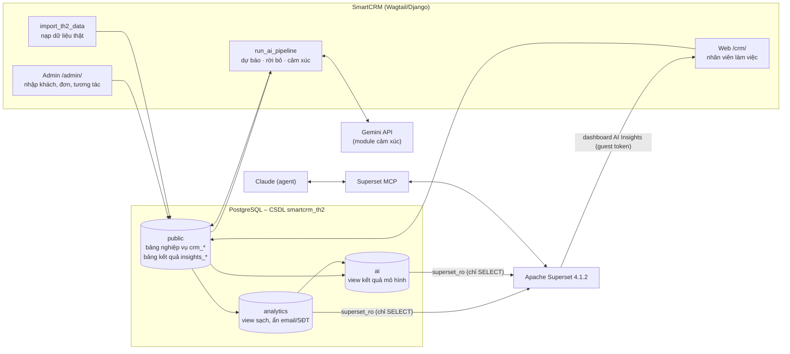
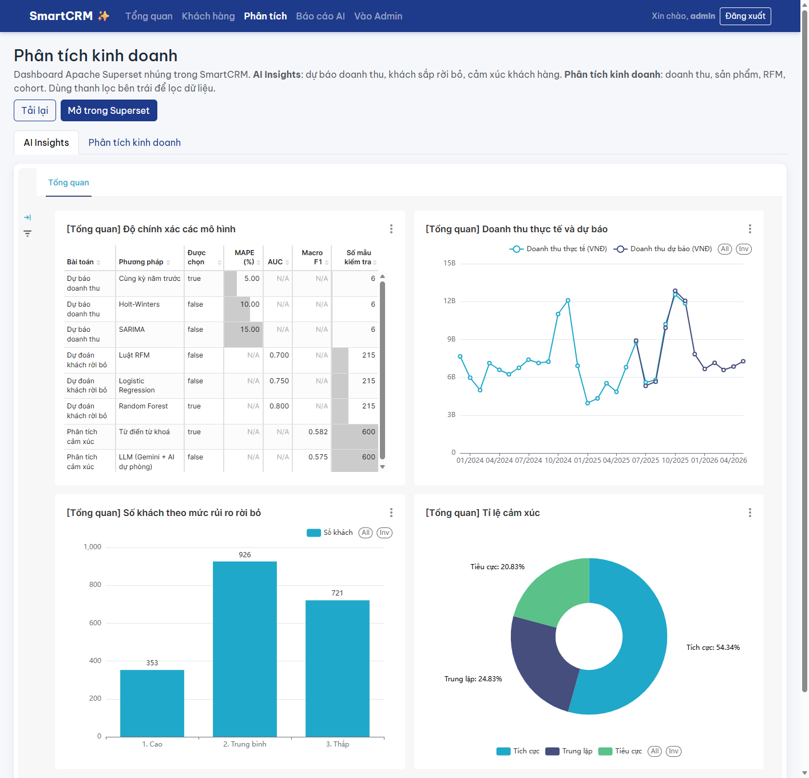

# 1. Kiến trúc và luồng dữ liệu (checklist 01)

*Người viết: Tùng*

## 1.1. Tổng quan

Module phân tích dữ liệu thông minh được xây trên hệ thống CRM **SmartCRM** (Wagtail CMS / Django) của nhóm. Dữ liệu
nghiệp vụ nằm trong PostgreSQL; các mô hình AI đọc dữ liệu thô, ghi kết quả ngược vào CSDL; Apache Superset đọc kết
quả qua một tầng view chỉ đọc và hiển thị thành dashboard, được nhúng lại vào giao diện SmartCRM. Superset MCP cho phép
trợ lý AI (Claude) tạo dataset và biểu đồ bằng câu lệnh tiếng Việt.

## 1.2. Các tầng

| Tầng | Thành phần | Vai trò |
|---|---|---|
| Nguồn | SmartCRM: Admin, web `/crm/`, lệnh `import_th2_data` | Nhập và lưu dữ liệu nghiệp vụ: khách hàng, đơn hàng, dòng sản phẩm, tương tác |
| CSDL trung tâm | PostgreSQL 16, CSDL `smartcrm_th2` | Nơi duy nhất chứa dữ liệu; tách riêng khỏi CSDL `smartcrm` của TH1 |
| Xử lý AI | App `insights`, lệnh `run_ai_pipeline` | Đọc dữ liệu thô qua Django ORM, chạy mô hình, ghi kết quả vào bảng `insights_*` |
| Phục vụ phân tích | Schema `analytics` (7 view, từ TH1) và `ai` (4 view, TH2) | Lớp chỉ đọc, đã làm sạch và ẩn dữ liệu cá nhân; chỉ lấy batch mô hình mới nhất |
| Trực quan hoá | Apache Superset, Superset MCP | Dataset, biểu đồ, dashboard "SmartCRM – AI Insights" |
| Người dùng | Trang Phân tích `/crm/analytics/`, trang chi tiết khách | Nhân viên xem dashboard và mức rủi ro rời bỏ ngay trong SmartCRM |

## 1.3. Dữ liệu

### Bán hàng – Online Retail II
- **Nguồn:** UCI Machine Learning Repository, *Online Retail II* (Chen, 2012, https://doi.org/10.24432/C5CG6D),
  giấy phép **CC BY 4.0**. Giao dịch thật của một cửa hàng bán lẻ trực tuyến ở Anh, 01/12/2009 – 09/12/2011,
  1.067.371 dòng, 5.942 mã khách.
- **Xử lý** (lệnh `python manage.py import_th2_data`):

| Bước | Quy ước | Lý do |
|---|---|---|
| Bỏ trùng | Hai sheet của file trùng 1.088 hoá đơn (01–09/12/2010); bỏ bản ở sheet đầu | Tránh đếm doanh thu hai lần |
| Lọc | Bỏ dòng không có mã khách, giá ≤ 0, mã hàng không bắt đầu bằng chữ số (phí ship POST, chiết khấu D, phí ngân hàng…) | Chỉ giữ hàng hoá thật gắn với khách |
| Lấy mẫu | 2.000 khách, `random_state=42` | Đủ lớn cho học máy, nạp nhanh; mọi máy ra cùng một bộ |
| Thời gian | Dời **+14 năm** (12/2009 → 12/2023, 12/2011 → 12/2025), giờ gốc coi là giờ Việt Nam | Giữ nguyên tháng nên giữ mùa vụ; dữ liệu gần hiện tại |
| Tiền tệ | 1 GBP = 33.000 VNĐ (tỉ giá cố định), làm tròn đến đồng | Thống nhất đơn vị VNĐ với SmartCRM |
| Trạng thái đơn | Hoá đơn mã `C…` → **Huỷ**, còn lại → **Hoàn thành** | Theo quy ước của bộ dữ liệu |
| Dòng sản phẩm | Gộp dòng cùng hoá đơn, cùng mã hàng, cùng đơn giá | Giữ đúng doanh thu |
| Sản phẩm | `track_stock=False` | Bộ dữ liệu không có tồn kho |
| Khách hàng | Tên `Khách UK-<mã>`, email `uk<mã>@khach.smartcrm.local`, nguồn Website; quốc gia ghi trong ghi chú đơn | Bộ dữ liệu đã ẩn danh, không có tên thật |
| Trạng thái khách | Không mua ≥ 180 ngày tính đến ngày tham chiếu → **Đã rời bỏ** | Cùng định nghĩa với mô hình rời bỏ |

- **Kết quả nạp:** 2.000 khách, 14.680 đơn (2.370 đơn huỷ), 255.715 dòng sản phẩm, 4.424 sản phẩm;
  thời gian 01/12/2023 – 09/12/2025; **ngày tham chiếu 09/12/2025**; doanh thu đơn Hoàn thành
  **186.513.155.070 VNĐ**; 24 tháng trọn vẹn (12/2023 – 11/2025); 805 khách Đã rời bỏ.

### Văn bản cảm xúc – nhận xét sản phẩm tiếng Việt
- **Nguồn:** Hugging Face `anotherpolarbear/vietnamese-sentiment-analysis`, giấy phép **MIT** theo trang dữ liệu:
  10.010 nhận xét điện thoại tiếng Việt, mỗi nhận xét chấm 1–5 sao. Nội dung giống các bộ đánh giá sản phẩm trên trang
  bán lẻ điện thoại; trang dữ liệu không ghi nguồn gốc, nên nhóm chỉ dùng cho mục đích học tập.
- **Nhãn:** 1–2 sao = **Tiêu cực**, 3 sao = **Trung lập**, 4–5 sao = **Tích cực**.
- **Xử lý:** bỏ câu rỗng và câu trùng; lấy mẫu phân tầng **3.000 câu** (`random_state=42`, giữ tỉ lệ nhãn: 1.898 tích
  cực, 721 tiêu cực, 381 trung lập); mỗi câu thành một bản ghi *Lịch sử tương tác* gắn **ngẫu nhiên** cho một khách đã
  mua, thời điểm trong khoảng khách đó còn mua hàng; kênh Email/Chat/Điện thoại/Trực tiếp theo tỉ lệ 40/40/10/10.
  Nhãn đúng lưu ở bảng `SentimentLabel`.
- ⚠️ **Hạn chế:** việc gắn nhận xét vào khách là **nhân tạo** (hai bộ dữ liệu khác nguồn). Kết quả cảm xúc theo khách
  hoặc theo kênh chỉ mang tính minh hoạ; còn độ chính xác của mô hình cảm xúc vẫn có giá trị vì so với nhãn thật.

## 1.4. Bảng kết quả AI và tầng view

*(Chi tiết cột: `docs/th2/HOP_DONG_DU_LIEU.md` mục 4 và 7.)*

| Bảng (app `insights`) | Nội dung | View cho Superset |
|---|---|---|
| `ModelRun` | Mỗi phương pháp của mỗi module trong một lần chạy: chỉ số đánh giá, tham số, trạng thái, phương pháp được chọn | `ai.model_run` |
| `RevenueForecast` | Doanh thu tháng: lịch sử, kiểm tra lại 6 tháng, dự báo 6 tháng tới kèm khoảng tin cậy 95% | `ai.revenue_forecast` |
| `ChurnScore` | Xác suất rời bỏ và mức rủi ro của từng khách | `ai.churn_score` |
| `SentimentLabel`, `SentimentResult` | Nhãn đúng và nhãn dự đoán của từng tin nhắn | `ai.interaction_sentiment` |

Mỗi view chỉ lấy **batch thành công mới nhất** của từng module, nên chạy lại mô hình là dashboard tự cập nhật. Lệnh
`seed_ai_demo` ghi kết quả giả (batch `demo`) để dựng dashboard trước khi có mô hình thật; batch thật luôn được ưu tiên.

## 1.5. Bảo mật

| Tài khoản | Dùng bởi | Quyền | Không làm được |
|---|---|---|---|
| `smartcrm` (PostgreSQL) | Wagtail, lệnh `import_th2_data`, `run_ai_pipeline` | Chủ CSDL `smartcrm_th2` | – (hạn chế còn lại, xem dưới) |
| `superset_ro` (PostgreSQL) | Superset đọc dữ liệu | `SELECT` trên schema `analytics`, `ai`; phiên luôn read-only; truy vấn tối đa 30 giây; tối đa 10 kết nối | Đọc bảng gốc `crm_*`, `insights_*`, `auth_user`; ghi bất kỳ dữ liệu nào |
| `mcp_agent` (Superset) | Claude qua Superset MCP | Vai trò `Gamma` + `sql_lab` + `TH2_MCP` (chỉ kết nối "SmartCRM TH2 (chỉ đọc)") | Truy cập CSDL TH1; chạy lệnh ghi (DML bị tắt); tạo kết nối CSDL; quản lý người dùng |
| `admin` (Superset) | Script `bootstrap_th2.py`, máy chủ Wagtail xin guest token | Quản trị | Không đưa cho trình duyệt hay agent |
| Guest token | Trình duyệt nhân viên xem dashboard nhúng | Chỉ xem đúng dashboard được cấp, hết hạn sau 5 phút | Mở SQL Lab, dataset, dashboard khác |

Các biện pháp khác:
- Mọi mật khẩu, khoá API nằm trong `.env` (không commit); mật khẩu `mcp_agent` nằm trong `tools/superset-mcp/.env` ngoài repo.
- View `analytics`, `ai` bỏ email, số điện thoại, nội dung tin nhắn; dashboard chỉ thấy tên hiển thị đã ẩn danh.
- Dữ liệu thật đều là bộ công khai đã ẩn danh; thư mục `data/` không commit.
- Cổng PostgreSQL và Superset chỉ mở trên `127.0.0.1`; Superset chỉ cho SmartCRM (`127.0.0.1:8000`, `localhost:8000`) đặt
  dashboard trong iframe.
- Lệnh `import_th2_data` từ chối chạy trên CSDL không có đuôi `_th2`, tránh ghi đè dữ liệu TH1.

Hạn chế còn lại (môi trường học tập): Wagtail dùng tài khoản chủ CSDL; kết nối nội bộ Docker không bật SSL; công cụ đăng nhập
của MCP cộng đồng trả access token cho agent. Triển khai thật nên tách tài khoản ứng dụng, bật `sslmode=require` và dùng MCP
chính thức của Superset 6.x với JWT.

## 1.6. SmartCRM hiển thị kết quả AI

Trang **Phân tích** (`/crm/analytics/`) có 2 tab: **AI Insights** (dashboard `smartcrm-ai-insights` của TH2) và **Phân tích
kinh doanh** (dashboard của TH1). Dashboard được nhúng bằng Superset Embedded SDK với guest token do máy chủ Wagtail xin
cho từng nhân viên đã đăng nhập; danh sách tab đặt trong `SUPERSET_DASHBOARDS` (settings).

