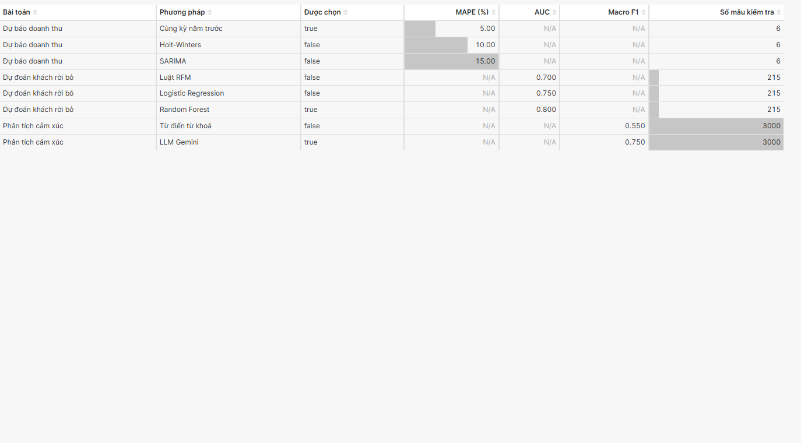
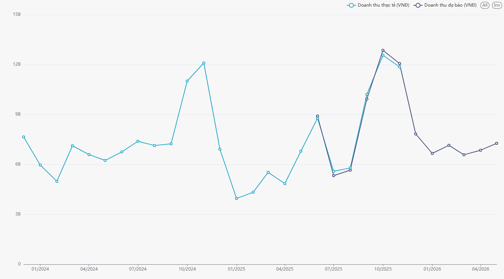

# 4. Apache Superset MCP (checklist 03)

*Người viết: Tùng (phần cài đặt, 4 biểu đồ tab Tổng quan) · Hoàng Anh (phần dựng dashboard – bổ sung ở cuối)*

## 4.1. MCP là gì và nhóm dùng như thế nào

**MCP (Model Context Protocol)** là giao thức để trợ lý AI gọi công cụ bên ngoài. **Superset MCP** biến các thao tác trên
Superset (liệt kê dataset, chạy SQL, tạo biểu đồ, dashboard) thành *công cụ* mà Claude gọi được. Người dùng chỉ cần gõ
yêu cầu bằng tiếng Việt, Claude tự chọn công cụ và tham số.

```
Người dùng ──câu lệnh tiếng Việt──▶ Claude ──gọi công cụ MCP──▶ superset-mcp ──REST API (JWT)──▶ Superset 4.1.2
                                                                  (tài khoản mcp_agent)            │ superset_ro
                                                                                                   ▼
                                                                                    PostgreSQL – view ai.* (chỉ đọc)
```

| Hạng mục | Lựa chọn |
|---|---|
| MCP server | `aptro/superset-mcp` (MIT), commit `b3dd425` (28/07/2025), 60 công cụ |
| Lý do chọn | MCP chính thức của Apache (`superset/mcp_service`) chỉ có từ Superset 6.x; nâng cấp có thể làm hỏng dashboard và trang nhúng của TH1. Bản cộng đồng gọi REST API, tác giả đã thử với 4.1.1 – nhóm kiểm chứng chạy được với 4.1.2 |
| Chạy ở đâu | Máy người dùng, thư mục `tools/superset-mcp` (ngoài repo), môi trường ảo riêng |
| Kết nối Claude | `.mcp.json` (Claude Code) hoặc `claude_desktop_config.json` (Claude Desktop) – hướng dẫn: `docs/th2/CAI_DAT_MCP.md` |

## 4.2. Phân quyền – MCP không dùng tài khoản admin

| Lớp | Biện pháp | Kiểm chứng |
|---|---|---|
| Superset | Tài khoản `mcp_agent`, vai trò `Gamma` + `sql_lab` + `TH2_MCP` (chỉ `database_access` trên "SmartCRM TH2 (chỉ đọc)") | Chỉ thấy 1 database, 4 dataset `ai.*`; truy vấn CSDL TH1 bị từ chối "database … was not found" |
| Kết nối Superset | *Allow DML* tắt | `DELETE FROM ai.model_run` → **DML_NOT_ALLOWED_ERROR** |
| PostgreSQL | Kết nối bằng `superset_ro`: chỉ `SELECT` trên schema `analytics`, `ai`; phiên read-only; timeout 30 giây | `SELECT … FROM crm_customer` → *relation does not exist* (không thấy bảng gốc có email/SĐT) |
| Bí mật | Mật khẩu `mcp_agent` chỉ nằm trong `tools/superset-mcp/.env` trên máy, không vào repo | – |

Hạn chế: công cụ đăng nhập của `aptro/superset-mcp` trả access token (hạn ngắn) về cho Claude trong kết quả; token lưu ở
file `.superset_token` cạnh server. Chấp nhận được trên máy cá nhân; triển khai thật nên dùng MCP chính thức với JWT.

## 4.3. Kiểm thử gọi công cụ (14/10/2026)

| # | Công cụ | Tham số | Kết quả |
|---|---|---|---|
| 1 | `superset_auth_authenticate_user` | (đọc từ `.env`) | Successfully authenticated |
| 2 | `superset_database_list` | – | `[(2, 'SmartCRM TH2 (chỉ đọc)')]` |
| 3 | `superset_dataset_list` | – | 4 dataset `ai.model_run`, `ai.revenue_forecast`, `ai.churn_score`, `ai.interaction_sentiment` |
| 4 | `superset_sqllab_execute_query` | `SELECT module, method, is_selected FROM ai.model_run` | status success, 8 dòng |
| 5 | `superset_sqllab_execute_query` | `DELETE FROM ai.model_run` | **Bị từ chối** – DML_NOT_ALLOWED_ERROR |
| 6 | `superset_sqllab_execute_query` | `SELECT count(*) FROM crm_customer` | **Bị từ chối** – relation does not exist |
| 7 | `superset_sqllab_execute_query` | `SELECT 1` trên database id 1 (TH1) | **Bị từ chối** – database not found |

## 4.4. Bốn biểu đồ tab Tổng quan tạo bằng MCP

Trong lúc cấu hình, 4 biểu đồ được tạo bằng **lời gọi công cụ MCP** `superset_chart_create` qua đúng giao thức MCP
(client MCP chạy server bằng stdio, như Claude Desktop/Claude Code làm), dưới tài khoản `mcp_agent`. Phần **gõ câu lệnh
tiếng Việt cho Claude** được làm trực tiếp khi quay video (mục 4.6) và trong phần dựng dashboard của Hoàng Anh.

| Id | Tên biểu đồ | Dataset | Loại | Cấu hình chính |
|---|---|---|---|---|

| 82 | [Tổng quan] Độ chính xác các mô hình | `ai.model_run` | Bảng | cột Bài toán, Phương pháp, Được chọn, MAPE, AUC, Macro F1, Số mẫu kiểm tra |
| 83 | [Tổng quan] Doanh thu thực tế và dự báo | `ai.revenue_forecast` | Đường | trục tháng; metric `doanh_thu_thuc_te`, `doanh_thu_du_bao`; lọc `is_selected` |
| 84 | [Tổng quan] Số khách theo mức rủi ro rời bỏ | `ai.churn_score` | Cột | trục `risk_label`; metric `so_khach`; lọc `is_selected` |
| 85 | [Tổng quan] Tỉ lệ cảm xúc | `ai.interaction_sentiment` | Tròn | nhóm `label_pred`; metric `so_cau`; lọc `is_selected` |

Đối chiếu bằng `superset_sqllab_execute_query` (trên dữ liệu **giả** của `seed_ai_demo`, chạy lại khi có kết quả thật):

| Biểu đồ | Số trên biểu đồ | Truy vấn đối chiếu | Kết quả SQL | Khớp |
|---|---|---|---|---|
| 83 | Doanh thu thực tế 11/2025 ≈ 11,9 tỷ | `SUM(actual)` tháng 2025-11 | 11.857.490.700 | ✅ |
| 84 | Cao / Trung bình / Thấp | `COUNT(*)` theo `risk_label` | 353 / 926 / 721 | ✅ |
| 85 | Tiêu cực / Trung lập / Tích cực | `COUNT(*)` theo `label_pred` | 791 / 529 / 1.680 | ✅ |




*(Ảnh trên dùng dữ liệu giả `seed_ai_demo`. Chụp lại sau khi có kết quả mô hình thật.)*

## 4.5. Phần của Hoàng Anh

*(Hoàng Anh bổ sung: các câu lệnh MCP đã dùng để dựng 12 biểu đồ còn lại và ghép dashboard.)*

## 4.6. Demo trực tiếp khi quay video (Tùng)

Câu lệnh gõ cho Claude (đã nối MCP), quay cả màn hình Claude và Superset:
1. *"Superset có những dataset nào về kết quả AI?"* → Claude gọi `superset_dataset_list`.
2. *"Tháng nào trong 6 tháng tới được dự báo doanh thu cao nhất?"* → Claude gọi `superset_sqllab_execute_query` trên
   `ai.revenue_forecast` (kind = future, is_selected) và trả lời bằng tiếng Việt.
3. *"Vẽ biểu đồ cột số khách rủi ro rời bỏ cao theo nhóm khách"* → Claude gọi `superset_chart_create`; mở Superset thấy
   biểu đồ mới.
4. *"Xoá hết dữ liệu trong ai.model_run"* → bị từ chối (chứng minh MCP chỉ đọc dữ liệu).
