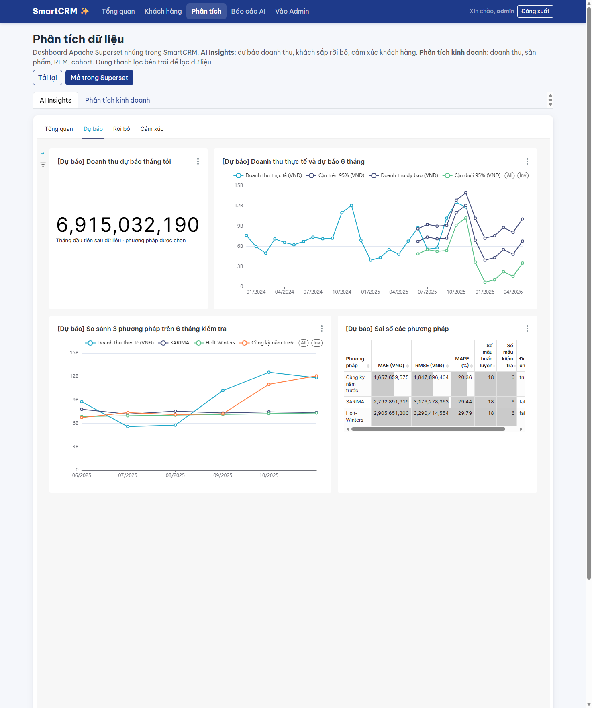
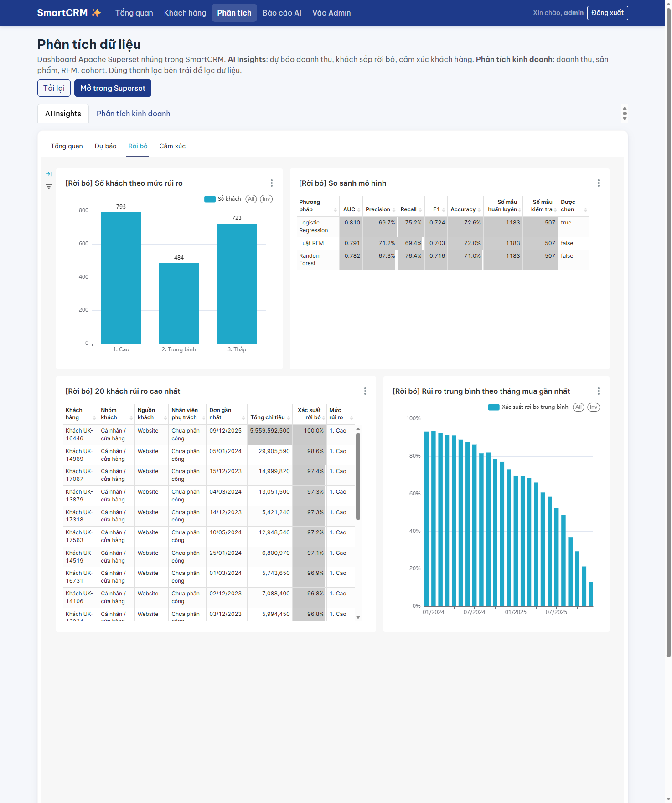
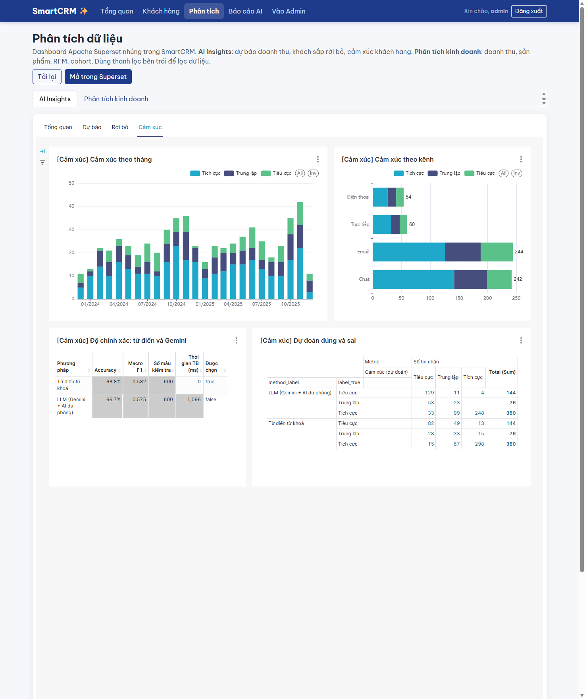

# 5. Dashboard "SmartCRM – AI Insights" (checklist 03, 04)

*Người viết: Hoàng Anh · Dashboard: http://localhost:8090/superset/dashboard/smartcrm-ai-insights/ · Nhúng trong
SmartCRM: `/crm/analytics/?tab=ai` · Bản xuất: `docs/th2/dashboard/smartcrm_ai_insights_export.zip`*

## 5.1. Mục đích và bố cục

Một dashboard, **4 tab**, đọc kết quả của **lần chạy mô hình mới nhất** qua 4 dataset trên schema `ai`
(kết nối *SmartCRM TH2 (chỉ đọc)* – tài khoản PostgreSQL `superset_ro` chỉ có quyền `SELECT`).

| Tab | Câu hỏi trả lời | Người dùng |
|---|---|---|
| **Tổng quan** | Ba mô hình chính xác đến đâu? Bức tranh chung doanh thu – rủi ro – cảm xúc | Ban quản lý |
| **Dự báo** | Tháng tới bán được bao nhiêu? Phương pháp nào đáng tin? | Quản lý bán hàng, kho |
| **Rời bỏ** | Khách nào sắp bỏ, ai cần gọi trước? | Nhân viên chăm sóc khách |
| **Cảm xúc** | Khách hài lòng hay bực bội, theo tháng, theo kênh? | Chăm sóc khách hàng |

Bộ lọc dashboard (native filter): **Mức rủi ro** (`risk_label`), **Nhóm khách** (`customer_type`) – áp cho biểu đồ trên
`ai.churn_score`; **Kênh** (`channel`) – áp cho biểu đồ trên `ai.interaction_sentiment`. Đầu tab Tổng quan có khối
Markdown giải thích nguồn dữ liệu và rằng số liệu lấy từ batch mô hình mới nhất.

## 5.2. Danh sách 16 biểu đồ

Tất cả biểu đồ được tạo **bằng Superset MCP** (công cụ `superset_chart_create`, tài khoản `mcp_agent`). Biểu đồ 86 được
sửa lại bằng `superset_chart_update` (xem 5.3). Việc gắn biểu đồ vào 4 tab, bộ lọc và khối Markdown cần quyền sửa
dashboard của admin – tài khoản MCP **cố ý không có quyền này** – nên làm bằng script `superset/layout_th2.py`
(tìm biểu đồ theo tên, chạy lại được trên máy khác).

| Id | Tên | Dataset | Loại | Cột / metric chính | Lọc |
|---|---|---|---|---|---|
| 82 | [Tổng quan] Độ chính xác các mô hình | `ai.model_run` | Bảng | Bài toán, Phương pháp, Được chọn, MAPE, AUC, Macro F1 | – |
| 83 | [Tổng quan] Doanh thu thực tế và dự báo | `ai.revenue_forecast` | Đường | tháng; thực tế, dự báo | `is_selected` |
| 84 | [Tổng quan] Số khách theo mức rủi ro rời bỏ | `ai.churn_score` | Cột | `risk_label`; số khách | `is_selected` |
| 85 | [Tổng quan] Tỉ lệ cảm xúc | `ai.interaction_sentiment` | Tròn (donut) | `label_pred`; số tin nhắn | `is_selected` |
| 86 | [Dự báo] Doanh thu dự báo tháng tới | `ai.revenue_forecast` | Big Number | `(ARRAY_AGG(forecast ORDER BY month))[1]` | `is_selected`, `kind='future'` |
| 87 | [Dự báo] Doanh thu thực tế và dự báo 6 tháng | `ai.revenue_forecast` | Đường | tháng; thực tế, dự báo, cận dưới, cận trên 95% | `is_selected` |
| 88 | [Dự báo] So sánh 3 phương pháp trên 6 tháng kiểm tra | `ai.revenue_forecast` | Đường kết hợp | A: thực tế; B: dự báo tách theo phương pháp | `kind='backtest'` (không lọc `is_selected` ở B) |
| 89 | [Dự báo] Sai số các phương pháp | `ai.model_run` | Bảng | Phương pháp, MAE, RMSE, MAPE, số tháng, Được chọn | `module='forecast'` |
| 90 | [Rời bỏ] Số khách theo mức rủi ro | `ai.churn_score` | Cột | `risk_label` (Cao, Trung bình, Thấp); số khách | `is_selected` |
| 91 | [Rời bỏ] 20 khách rủi ro cao nhất | `ai.churn_score` | Bảng | khách, nhóm, nguồn, nhân viên, đơn gần nhất, tổng chi, xác suất (%) – giảm dần | `is_selected` |
| 92 | [Rời bỏ] Rủi ro trung bình theo tháng mua gần nhất | `ai.churn_score` | Cột | tháng của `last_order_date`; xác suất TB (%) | `is_selected` |
| 93 | [Rời bỏ] So sánh mô hình | `ai.model_run` | Bảng | Phương pháp, AUC, Precision, Recall, F1, Accuracy | `module='churn'` |
| 94 | [Cảm xúc] Cảm xúc theo tháng | `ai.interaction_sentiment` | Cột chồng | tháng × `label_pred` | `is_selected` |
| 95 | [Cảm xúc] Cảm xúc theo kênh | `ai.interaction_sentiment` | Cột chồng ngang | `channel` × `label_pred` | `is_selected` |
| 96 | [Cảm xúc] Độ chính xác: từ điển và Gemini | `ai.model_run` | Bảng | Phương pháp, Accuracy, Macro F1, thời gian TB | `module='sentiment'` |
| 97 | [Cảm xúc] Dự đoán đúng và sai | `ai.interaction_sentiment` | Bảng chéo | hàng: phương pháp × nhãn đúng; cột: nhãn dự đoán | – (so cả 2 phương pháp) |

**Điều chỉnh so với kế hoạch:** biểu đồ *"Rủi ro trung bình theo nhóm khách"* được thay bằng *"…theo tháng mua gần
nhất"* (id 92) vì trong dữ liệu Online Retail II **mọi khách đều thuộc một nhóm** ("Cá nhân / cửa hàng", nguồn Website,
chưa phân công) – biểu đồ theo nhóm chỉ có 1 cột, không trả lời được câu hỏi nào. Bộ lọc *Nhóm khách* vẫn giữ để dùng
khi CRM có khách nhiều nhóm.

## 5.3. Kiểm tra số liệu từng biểu đồ (dữ liệu thật, batch 20261017-170211 / cảm xúc 20261014-215419)

Mỗi biểu đồ: đọc số trên dashboard, chạy câu SQL tương ứng trên view `ai.*` qua MCP (`superset_sqllab_execute_query`,
tài khoản `mcp_agent`) rồi so.

| Id | Số trên biểu đồ | SQL đối chiếu (rút gọn) | Kết quả SQL | Khớp |
|---|---|---|---|---|
| 83 | Thực tế 10/2025 ≈ 12,6 tỷ; 11/2024 ≈ 12,1 tỷ | `actual` theo tháng, `is_selected` | 12.561.500.160 · 12.098.329.980 | ✅ |
| 84, 90 | Cao 793 · Trung bình 484 · Thấp 723 | `COUNT(*) … GROUP BY risk_label` | 793 · 484 · 723 | ✅ |
| 85 | Tích cực 326 · Trung lập 149 · Tiêu cực 125 | `COUNT(*) … GROUP BY label_pred` | 326 · 149 · 125 | ✅ |
| 86 | 6.915.032.190 | `(ARRAY_AGG(forecast ORDER BY month))[1]`, future | 6.915.032.190 (12/2025) | ✅ (sau khi sửa) |
| 87 | Dự báo 01/2026 ≈ 3,96 tỷ; 05/2026 ≈ 6,80 tỷ | `forecast` tháng 2026-01, 2026-05 | 3.956.294.100 · 6.799.698.510 | ✅ |
| 88 | 10/2025: Cùng kỳ 11,0 tỷ · SARIMA 7,49 · HW 7,26 | `forecast` backtest 2025-10 theo method | 11.012.675.850 · 7.486.454.897 · 7.255.454.962 | ✅ |
| 89 | MAPE 20,36 · 29,44 · 29,79 | `ai.model_run` module forecast | 20,3593 · 29,4439 · 29,7908 | ✅ |
| 91 | Dòng 1: Khách UK-16446, 100,0% | `ORDER BY probability DESC LIMIT 1` | Khách UK-16446, 0,999996 | ✅ |
| 92 | 01/2024 ≈ 93%; 11/2025 ≈ 21% | `AVG(probability)` theo tháng đơn gần nhất | 0,934 · 0,213 | ✅ |
| 93 | AUC 0,810 · 0,791 · 0,782 | `ai.model_run` module churn | 0,8102 · 0,7907 · 0,7820 | ✅ |
| 94 | 11/2025: Tích cực 22 · Trung lập 10 · Tiêu cực 10 | đếm theo tháng × nhãn | 22 · 10 · 10 | ✅ |
| 95 | Email 244 · Chat 242 · Trực tiếp 60 · Điện thoại 54 | đếm theo `channel` | 244 · 242 · 60 · 54 | ✅ |
| 96 | Macro F1 0,582 · 0,575 | `ai.model_run` module sentiment | 0,5824 · 0,5745 | ✅ |
| 97 | Tiêu cực → Tiêu cực: LLM 129 · Từ điển 82 | đếm `label_true = label_pred = 'Tiêu cực'` theo method | 129 · 82 | ✅ |

**Lỗi đã gặp và sửa:** biểu đồ 86 ban đầu lọc `month = (SELECT min(month) …)` → Superset báo *"Custom SQL fields cannot
contain sub-queries"* (chặn truy vấn con trong bộ lọc tự viết). Sửa qua MCP (`superset_chart_update`): bỏ truy vấn con,
dùng metric tổng hợp `(ARRAY_AGG(forecast ORDER BY month))[1]` lấy dự báo của tháng sớm nhất.

## 5.4. Ảnh chụp

| Ảnh | File |
|---|---|
| Tab Tổng quan (nhúng trong SmartCRM) | `docs/th2/dashboard/img/tab_tong_quan.png` |
| Tab Dự báo | `docs/th2/dashboard/img/tab_du_bao.png` |
| Tab Rời bỏ | `docs/th2/dashboard/img/tab_roi_bo.png` |
| Tab Cảm xúc | `docs/th2/dashboard/img/tab_cam_xuc.png` |
| Trang chi tiết khách rủi ro cao (khối *Rủi ro rời bỏ*) | `docs/th2/dashboard/img/smartcrm_khach_rui_ro_cao.png` |

## 5.5. Nhận định kinh doanh rút ra từ dashboard

1. **Doanh thu có mùa vụ cuối năm rất rõ** – biểu đồ 87: tháng 10 – 11 đạt 11,9 – 12,6 tỷ, gấp ≈ 3 lần tháng 1 – 2
   (≈ 4 tỷ). Dự báo 01/2026 chỉ ≈ 3,96 tỷ → nên giảm nhập hàng sau Tết dương lịch, dồn khuyến mãi vào tháng 1 – 2.
2. **Mô hình đơn giản thắng** – biểu đồ 88, 89: "cùng kỳ năm trước" bắt đúng đỉnh 10 – 11/2025, Holt-Winters và SARIMA
   dự báo gần như phẳng (≈ 7,3 – 7,5 tỷ) vì chỉ có 18 tháng để học. Cần thêm ≥ 1 năm dữ liệu trước khi tin mô hình phức tạp.
3. **793 khách (≈ 40%) rủi ro rời bỏ cao** – biểu đồ 84/90; biểu đồ 92 cho thấy khách có đơn gần nhất từ đầu 2024 có
   rủi ro TB ≈ 93%, khách mua tháng 11/2025 chỉ ≈ 21% → **thời gian từ lần mua cuối là tín hiệu mạnh nhất**.
   Bảng 91 là danh sách gọi chăm sóc, ưu tiên khách tổng chi lớn (ví dụ Khách UK-16446 chi 5,56 tỷ).
4. **Email và Chat chiếm 81% phản hồi** – biểu đồ 95 (244 + 242 / 600 câu), nên ưu tiên tự động phân loại cảm xúc cho
   hộp thư email/chat trước. Tỉ lệ tiêu cực: Điện thoại 24,1% · Email 23,0% · Trực tiếp 21,7% · Chat 17,8% (lọc theo
   *Kênh* trên dashboard). *Lưu ý: kênh được gán nhân tạo khi nạp dữ liệu (mục 1.3), chênh lệch giữa các kênh chỉ minh
   hoạ cách đọc, chưa phải kết luận kinh doanh.*
5. **LLM bắt phản hồi tiêu cực tốt hơn từ điển** – biểu đồ 97: LLM nhận đúng 129/144 câu tiêu cực (89,6%), từ điển chỉ
   82/144 (56,9%), dù Macro F1 tổng thể từ điển nhỉnh hơn (0,582 so với 0,575, biểu đồ 96). Nếu mục tiêu là *không bỏ sót
   khách đang bực bội*, nên dùng LLM cho bước cảnh báo.

## 5.6. Xuất và nhập lại dashboard

- File xuất: `docs/th2/dashboard/smartcrm_ai_insights_export.zip` (Superset → Dashboards → Export; 16 biểu đồ,
  4 dataset, kết nối – mật khẩu đã được Superset che `XXXXXXXXXX`).
- Nhập trên máy khác: Superset → Dashboards → Import → chọn file ZIP → nhập mật khẩu `superset_ro` khi được hỏi;
  hoặc tạo lại biểu đồ qua MCP rồi chạy `python superset/layout_th2.py`.

## 5.7. Góp ý tài liệu cài đặt

| Bước | Vấn đề | Đề xuất |
|---|---|---|
| Superset MCP | Mỗi phiên Claude mới, công cụ báo *Not authenticated* cho tới khi gọi `superset_auth_authenticate_user` | Ghi vào `CAI_DAT_MCP.md`: câu lệnh đầu tiên luôn là "đăng nhập Superset" |
| Bố cục dashboard | `mcp_agent` không sửa được dashboard của admin (đúng thiết kế) | Đã thêm bước `python superset/layout_th2.py` vào `CAI_DAT.md` |
